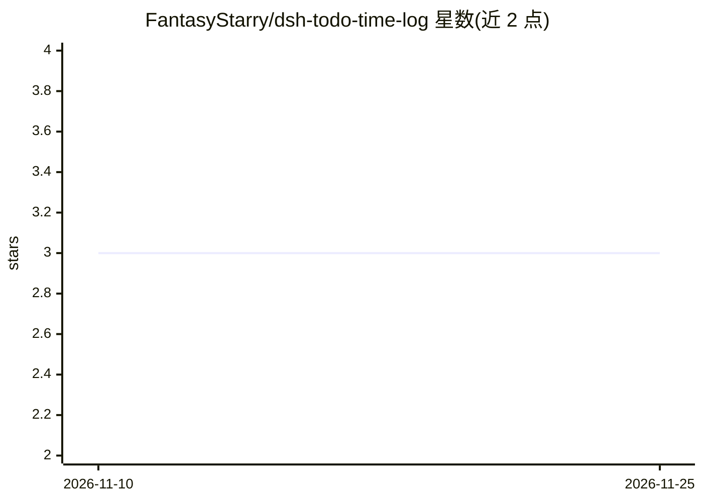

# FantasyStarry/dsh-todo-time-log

⭐ 3 · JavaScript · MIT · 推送 2026-11-21 · [GitHub](https://github.com/FantasyStarry/dsh-todo-time-log) · [官网](https://www.npmjs.com/package/dsh-todo-time-log) · 个人维护 · 中文 README

**DeepSeek Harness 待办插件：自动记录每条待办耗时**

运行于 DeepSeek Harness（dsh）宿主的待办管理插件：创建与完成时刻自动落盘本地 JSON，以表格、看板、甘特图、日历、回顾五种视图呈现每条待办的真实耗时；支持分类、优先级、类型、@工作区文件引用、预计用时对照与搁置机制。提供面板表单、对话式批量录入、/todo 命令、智能体工具 todo_time_log 与输入框胶囊五种录入入口，解析规则共用一份实现。数据仅存本地、不联网；要求 DSH 0.2.0-rc.2 至 0.2.3 与 Node.js ≥ 20，经插件管理器安装。

## 筛选速览

| 维度 | 判定 | 备注 |
|---|---|---|
| AI 角色 | `ai-enhanced` | 去掉 AI 部分产品仍成立 |
| 许可风险 | `permissive` | MIT |
| 部署形态 | `library` | 以包/库形式分发 |
| 模型依赖 | — | README 未给出锁定关系 |
| 硬件要求 | — | 无带数字的原话,不猜 |
| 安装摩擦 | `low` | 无编译、无系统依赖或容器化 |
| 成熟度 | — | 结构信号不足 |

## 能力要点

- 自动记录每条待办的创建与完成时间，甘特图一根条对应完整生命周期
- 五种录入入口共用同一解析实现（#分类、@文件、!优先级、^类型、~预计用时）
- 智能体可调用 todo_time_log 工具执行 list/create/complete 等操作，与 HTTP 接口共用业务实现
- 本地 JSON 存储，原子写入、跨进程文件锁与损坏自愈

## 适用场景

- 在 DeepSeek Harness 里管理待办并查看每件事实际花了多久
- 通过对话一句话批量录入多条待办
- 让智能体代为创建、查询、勾掉待办
- 导出 CSV 用 Excel 统计耗时

## 场景标签

 · 领域:生产力/任务管理

## 证据(README 行号)

> L15:  一个 DeepSeek Harness（dsh）插件：管理待办的同时， 自动记下每条待办的创建时间与完成时间 ，
> L139: |🤖 智能体工具|智能体可 `list / get / create / complete / uncomplete / update / delete / health`，与 UI 共用同一实现|
> L197: |智能体工具|让模型调用 `todo_time_log`（`create` / `complete` / `list` …）|让 AI 代记、代查|

## 星数曲线

2026-11-10 3 → 2026-11-25 3（+0）

---
*卡片 v1 · prompt 1.4 · 生成 2026-11-22 · 置信度 high · 依据 README sha `b548328a9017` · [字段定义](../../DATASET.md)*
