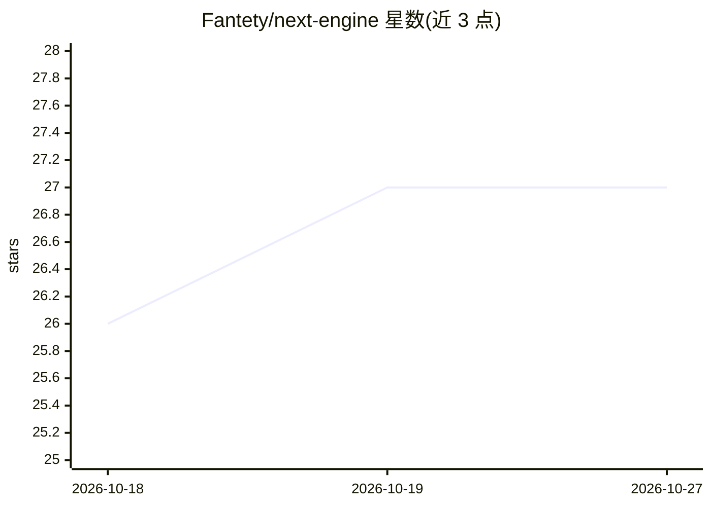

# Fantety/next-engine

⭐ 27 · C++ · NOASSERTION · 推送 2026-07-10 · [GitHub](https://github.com/Fantety/next-engine) · [官网](https://nextengine.net) · 个人维护 · 中文 README

**Godot 分支游戏引擎，内置编辑器 AI Agent 开发助手**

基于 Godot Engine 4.x 的多平台 2D/3D 游戏引擎分支，保留场景树、脚本、资源与调试工作流，新增编辑器原生 AI 层：AI Dock 聊天面板、Agent V1 后端（持久会话、事件日志、工具调用、中断恢复）、读写文件/编辑场景与脚本的内置工具、统一权限流，以及 MCP 集成与 Skill 系统。更改可经 diff review 审查。处于 preview 阶段（v0.1.4.7.1-preview），CI 发布 Android/iOS/macOS/Windows/Web 资产，Linux 不在主发布流程；源码用 scons 构建。

## 筛选速览

| 维度 | 判定 | 备注 |
|---|---|---|
| AI 角色 | `ai-enhanced` | 去掉 AI 部分产品仍成立 |
| 许可风险 | `permissive` | NOASSERTION |
| 部署形态 | `desktop` | 安装包/桌面程序 |
| 模型依赖 | — | README 未给出锁定关系 |
| 硬件要求 | — | 无带数字的原话,不猜 |
| 安装摩擦 | `low` | 无编译、无系统依赖或容器化 |
| 成熟度 | `idea` | |

## 能力要点

- AI Dock 支持聊天、模型选择、附件、token 用量与 diff review
- Agent V1 后端：持久会话、事件日志、工具结算、中断恢复与压缩
- 内置读写文件、编辑场景/脚本/Shader 的项目工具，带统一权限流
- MCP 集成与按需加载的 Skill 工作流指引系统

## 适用场景

- 在熟悉的 Godot 工作流中用 AI Agent 编辑场景与脚本
- 通过 diff review 审查 AI 所做的项目更改
- 以 MCP 服务器和 Skill 扩展编辑器的 AI 工作流

## 场景标签

`编码 Agent` · 领域:编码与开发

## 证据(README 行号)

> L5: NEXT Engine is a fork of Godot Engine that brings AI-assisted development directly into the editor. It keeps the fam
> L23: - AI Dock for chat, model selection, attachments, progress, token usage, todos, permission prompts, and diff review
> L25: - Built-in project/editor tools for reading and searching files, editing scenes, writing scripts, editing shaders, 

## 星数曲线

2026-10-18 26 → 2026-10-27 27（+1）

---
*卡片 v1 · prompt 1.4 · 生成 2026-10-26 · 置信度 high · 依据 README sha `0d07f2e0d001` · [字段定义](../../DATASET.md)*
