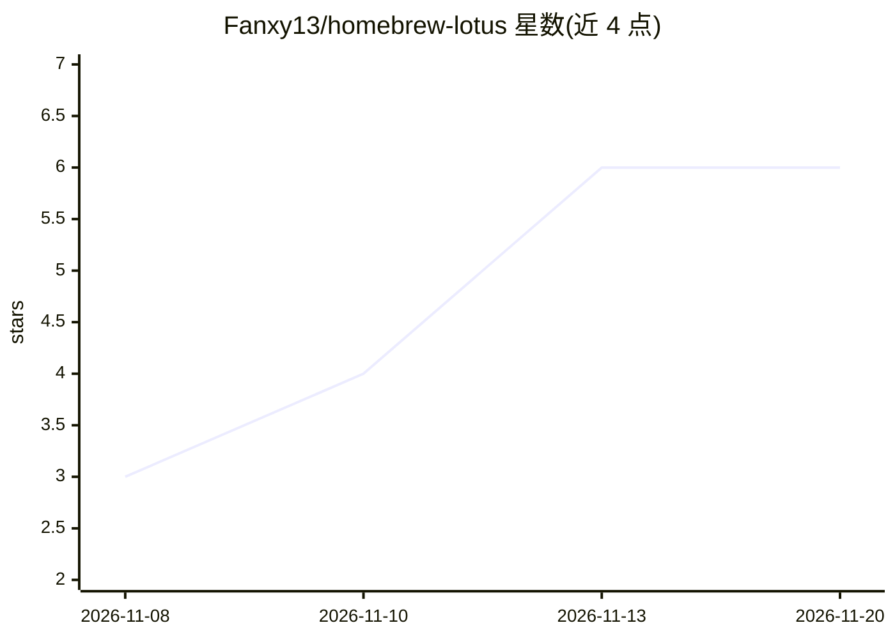

# Fanxy13/homebrew-lotus

⭐ — · [GitHub]() · 个人维护

**为 macOS/Linux/Windows 终端提供启动屏与 AI 助手等命令集**

Lotus 是一个加载到 zsh/bash/PowerShell 的终端增强工具，提供启动屏、应用打开、软件安装（Homebrew Cask）、天气、时钟、媒体控制、图片转换与本地抠图、Minecraft 服务器管理等命令。AI 部分：/ai 终端聊天与文件操作，可连接 Claude、Apple Intelligence、Ollama 或 OpenAI 兼容 API，本地模型经 Apple MLX 运行，并可在浏览器中提供同一 AI 的 web 聊天。通过 curl 安装脚本或 Homebrew 分发，Windows 为 beta。

## 筛选速览

| 维度 | 判定 | 备注 |
|---|---|---|
| AI 角色 | `ai-enhanced` | 去掉 AI 部分产品仍成立 |
| 许可风险 | `permissive` | — |
| 部署形态 | `desktop` | 安装包/桌面程序 |
| 模型依赖 | local-ok | 支持本地模型 |
| 硬件要求 | — | 无带数字的原话,不猜 |
| 安装摩擦 | `low` | 无编译、无系统依赖或容器化 |
| 成熟度 | — | 结构信号不足 |

## 能力要点

- /ai 终端：聊天、写代码、改文件、运行命令（变更前询问）
- 本地模型经 Apple MLX 运行，含 gpt-oss-20b 调优版 Nucifera 20B
- /bg remove 用 BiRefNet 或 InSPyReNet 在本地抠图
- 浏览器 web 聊天（127.0.0.1:3000）与 /ai 同一后端

## 适用场景

- 在终端里直接向 AI 提问、解释报错、起草文本
- 在 Mac 本地批量抠图并导出透明 PNG
- 用一条命令浏览并安装 78 个精选应用
- 给终端加上启动屏、时钟、天气等日常小工具

## 场景标签

`AI 助手` `图像视频处理` · 领域:对话与助手

## 证据(README 行号)

> L5: **A start screen and command center for the terminal – on macOS, Linux and Windows (beta).**
> L130: |AI|`/ai`|The AI terminal: chat, write code, create and change files, run commands – it asks before every change|

## 星数曲线

2026-11-08 3 → 2026-11-20 6（+3）

---
*卡片 v1 · prompt 1.4 · 生成 2026-11-20 · 置信度 mid · 依据 README sha `b29174bbf3bc` · [字段定义](../../DATASET.md)*
