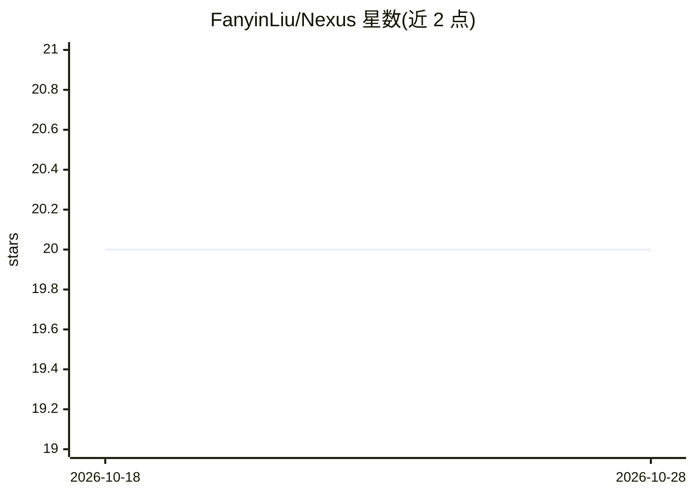

# FanyinLiu/Nexus

⭐ 20 · TypeScript · MIT · 推送 2026-10-28 · [GitHub](https://github.com/FanyinLiu/Nexus) · [官网](https://github.com/FanyinLiu/Nexus/releases/latest) · 个人维护 · 中文 README

**本地优先的 Live2D 桌面 AI 伙伴：常驻桌面、记忆、文字/语音对话**

基于 Electron + React + TypeScript 的桌面应用，以 Live2D 桌宠形象（内置 Mao/Haru/Hiyori）常驻桌面，提供文字对话为默认入口、可选语音输入输出。模型连接默认走本地 Ollama（127.0.0.1:11434，qwen3:8b），也支持 DeepSeek、OpenAI-compatible 与自定义接口，API Key 仅存本机。包含本地长期记忆（夜间整理、矛盾降权）、授权后的搜索/天气/提醒辅助，以及短期粗粒度可暂停的桌面陪伴摘要。限制：安装包未签名（SmartScreen/Gatekeeper 提示），仍在活跃开发，Windows x64/macOS arm64/Linux x64 提供安装包，无 macOS x64。

## 筛选速览

| 维度 | 判定 | 备注 |
|---|---|---|
| AI 角色 | `ai-native` | 本体是模型或模型工具 |
| 许可风险 | `permissive` | MIT |
| 部署形态 | `desktop` | 安装包/桌面程序 |
| 模型依赖 | local-ok | 支持本地模型 |
| 硬件要求 | — | 无带数字的原话,不猜 |
| 安装摩擦 | `low` | 无编译、无系统依赖或容器化 |
| 成熟度 | `idea` | |

## 能力要点

- Live2D 桌宠常驻桌面，支持导入 Cubism 模型并在激活前检查资源
- 默认走本地 Ollama（qwen3:8b），可选 DeepSeek、OpenAI-compatible 等云端目录，密钥留在本机
- 本地长期记忆与夜间矛盾检测降权；桌面陪伴摘要短期、粗粒度、可暂停可清理
- 授权辅助（搜索/天气/提醒）需用户明确授权，可确认、可停止、可审计

## 适用场景

- 桌面上常驻一个能文字/语音对话并记住偏好的 AI 伙伴
- 不把数据发云端，用本地 Ollama 跑 AI 对话
- 希望 AI 帮忙做提醒、搜索等轻量事务且每个动作经过授权

## 场景标签

`AI 助手` `语音 Agent` · 领域:对话与助手

## 证据(README 行号)

> L5: Nexus 是一个 **本地优先的 AI 桌面伙伴**。
> L17: - **桌宠形象**：伙伴以 Live2D 常驻桌面，而不是只存在于聊天记录里。内置形象是 Mao、Haru 和 Hiyori，默认是 Mao。导入 Cubism 模型会在激活前检查资源；缺动作或表情仍可显示并说明限制。
> L18: - **自然对话**：文字是默认入口；语音输入/输出可选，目录里包含 Grok STT/TTS。

## 星数曲线

2026-10-18 20 → 2026-10-28 20（+0）

---
*卡片 v1 · prompt 1.4 · 生成 2026-10-28 · 置信度 mid · 依据 README sha `7cb393e46ead` · [字段定义](../../DATASET.md)*
