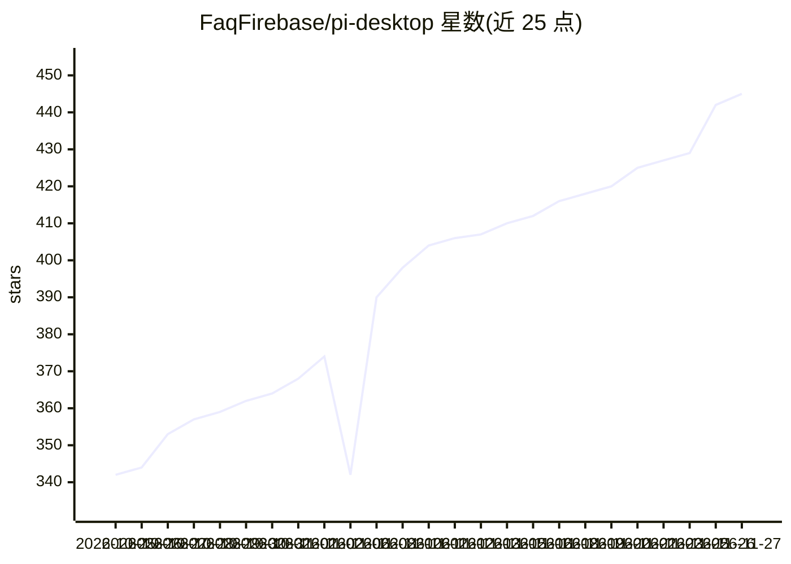

# FaqFirebase/pi-desktop

⭐ 445 · TypeScript · Apache-2.0 · 推送 2026-11-26 · [GitHub](https://github.com/FaqFirebase/pi-desktop) · [官网](https://pi-desktop.com) · 组织维护 · 中文 README

**Pi/oh-my-pi 编码 agent 的免费开源桌面 GUI**

面向 Pi 与 oh-my-pi 编码 agent 的 Electron 桌面客户端：在同一窗口提供流式对话（含工具调用折叠、diff 展示）、文件浏览、CodeMirror 编辑器、终端、diff 审查与 Git 操作（Commit/Push/PR）。通过 Pi 的 RPC 协议运行 pi 或 omp 引擎，每个会话独立 agent 进程，支持多工作区、Linked tasks 跨仓库任务、Git worktree 隔离。权限系统提供四种基础模式与自定义 allow/deny 规则（明确声明非安全沙箱）。处于 alpha 阶段。

## 筛选速览

| 维度 | 判定 | 备注 |
|---|---|---|
| AI 角色 | `ai-ecosystem` | LLM/agent 周边工具 |
| 许可风险 | `permissive` | Apache-2.0 |
| 部署形态 | `desktop` | 安装包/桌面程序 |
| 模型依赖 | — | README 未给出锁定关系 |
| 硬件要求 | — | 无带数字的原话,不猜 |
| 安装摩擦 | `low` | 无编译、无系统依赖或容器化 |
| 成熟度 | `idea` | |

## 能力要点

- 兼容 Pi 与 oh-my-pi 双引擎（RPC 协议），会话历史互通
- 四种权限模式与按工具/glob 的 allow/deny 规则
- Linked tasks：一次任务跨多个 Git 仓库并批量开 PR
- 7 内置主题与自定义主题（pi-theme/v1 JSON 格式），界面支持 5 种语言含简体中文

## 适用场景

- 在桌面 GUI 里管理和运行 Pi/OMP 编码 agent 会话
- 跨多个 Git 仓库发起联动修改并统一提交开 PR
- 按工作区精细控制 agent 的文件编辑与命令执行权限
- 查看 agent 用量统计与 subagent 只读转录

## 场景标签

`编码 Agent` · 领域:编码与开发

## 证据(README 行号)

> L3: A desktop GUI for the Pi and oh-my-pi coding agents. Chat, manage projects, browse files, run commands, and install 
> L54: Pi Desktop speaks Pi's RPC protocol, so it can run either the standard `pi` CLI or the compatible `omp` binary from

## 星数曲线

2026-10-25 342 → 2026-11-27 445（+103）

---
*卡片 v1 · prompt 1.4 · 生成 2026-11-27 · 置信度 mid · 依据 README sha `c08907af4ad8` · [字段定义](../../DATASET.md)*
