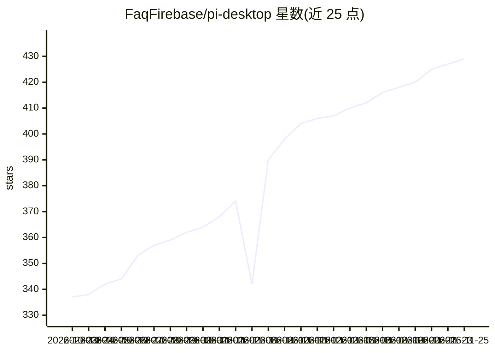

# FaqFirebase/pi-desktop

⭐ 429 · TypeScript · Apache-2.0 · 推送 2026-11-23 · [GitHub](https://github.com/FaqFirebase/pi-desktop) · [官网](https://pi-desktop.com) · 个人维护

**给 Pi/oh-my-pi 编码 agent 提供的开源桌面 GUI**

Pi Desktop 是为 Pi 与 oh-my-pi 编码 agent 提供的桌面图形界面，基于 Electron 构建，支持 Linux/macOS/Windows，目前处于 alpha 阶段。它通过 Pi 的 RPC 协议连接引擎，提供流式聊天（含工具调用与 diff 展示）、文件浏览与编辑、终端、diff 审查与 Git 操作（commit/push/PR）、多工作区与后台会话、四级权限模式加自定义 allow/deny 规则、包浏览器与用量统计。用户需自行安装 Pi 或 omp 引擎，会话与模型配置存于各引擎目录。

## 筛选速览

| 维度 | 判定 | 备注 |
|---|---|---|
| AI 角色 | `ai-ecosystem` | LLM/agent 周边工具 |
| 许可风险 | `permissive` | Apache-2.0 |
| 部署形态 | `desktop` | 安装包/桌面程序 |
| 模型依赖 | — | README 未给出锁定关系 |
| 硬件要求 | — | 无带数字的原话,不猜 |
| 安装摩擦 | `low` | 无编译、无系统依赖或容器化 |
| 成熟度 | `idea` | |

## 能力要点

- 通过 RPC 协议同时支持 pi 与 omp 两种引擎，可切换并读取双方会话历史
- 四级权限模式（Plan/Ask edits/Ask commands/Trusted）与 glob 模式的 allow/deny 规则
- Linked tasks 跨多 Git 仓库协作，隔离 worktree 并批量开 PR
- 多 Agent Council Planning：Pi/Claude/Codex 各自只读规划后合并共识计划（opt-in）

## 适用场景

- 在图形界面里使用 Pi/oh-my-pi 编码 agent 进行聊天、改代码和跑终端
- 审查 agent 会话修改的文件 diff 并做 Git 提交或开 PR
- 按工作区配置精细权限规则，限制 agent 可执行的工具
- 让多个 agent（Pi/Claude/Codex）先各自规划再执行编码任务

## 场景标签

`编码 Agent` · 领域:编码与开发

## 证据(README 行号)

> L3: A desktop GUI for the Pi and oh-my-pi coding agents. Chat, manage projects, browse files, run commands, and install 
> L52: Pi Desktop speaks Pi's RPC protocol, so it can run either the standard `pi` CLI or the compatible `omp` binary from

## 星数曲线

2026-10-23 337 → 2026-11-25 429（+92）

---
*卡片 v1 · prompt 1.4 · 生成 2026-11-25 · 置信度 high · 依据 README sha `4d6313b5b862` · [字段定义](../../DATASET.md)*
