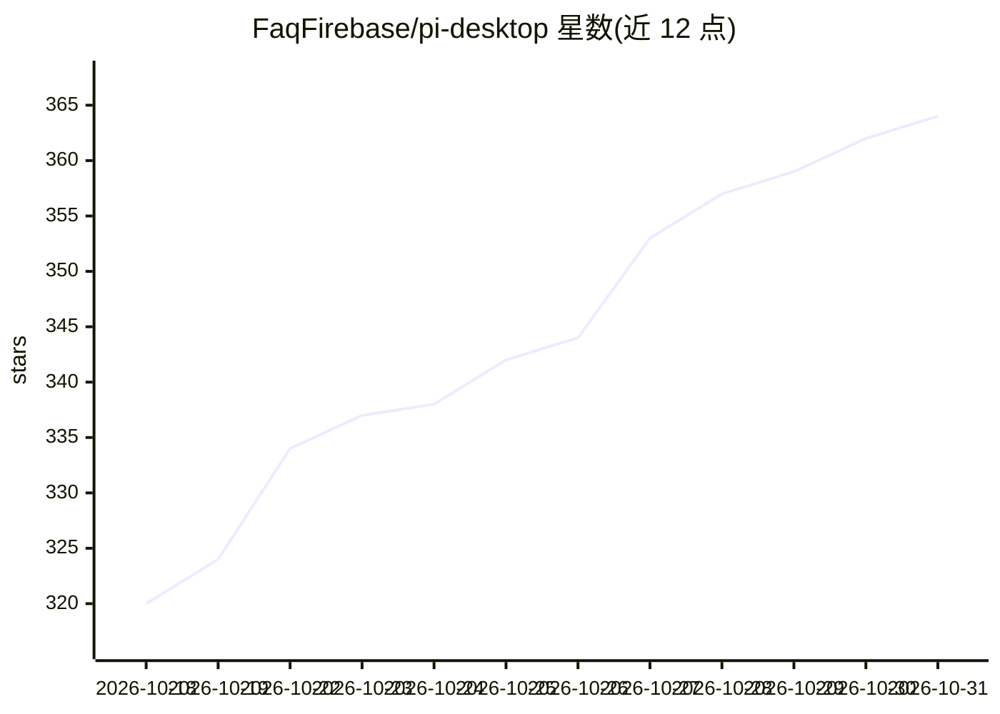

# FaqFirebase/pi-desktop

⭐ 364 · TypeScript · Apache-2.0 · 推送 2026-10-26 · [GitHub](https://github.com/FaqFirebase/pi-desktop) · [官网](https://pi-desktop.com) · 组织维护 · 中文 README

**Pi 编码 agent 的跨平台桌面 GUI 客户端**

基于 Electron 的桌面应用，为 Pi 与 oh-my-pi（OMP）编码 agent 提供图形界面：流式聊天、文件树、diff 查看与 Git 提交/PR、每工作区终端、权限模式与自定义 allow/deny 规则、多工作区并行会话（每个会话独立 agent 进程）、跨多仓库的 Linked tasks 与一键开 PR。通过 Pi 的 RPC 协议与 pi/omp 引擎通信，支持自定义模型与 providers 编辑。另含子 agent 面板、用量统计、主题系统与中英文界面。自述处于 alpha 阶段。

## 筛选速览

| 维度 | 判定 | 备注 |
|---|---|---|
| AI 角色 | `ai-ecosystem` | LLM/agent 周边工具 |
| 许可风险 | `permissive` | Apache-2.0 |
| 部署形态 | `desktop` | 安装包/桌面程序 |
| 模型依赖 | — | README 未给出锁定关系 |
| 硬件要求 | — | 无带数字的原话,不猜 |
| 安装摩擦 | `low` | 无编译、无系统依赖或容器化 |
| 成熟度 | `idea` | |

## 能力要点

- 通过 Pi RPC 协议运行 pi CLI 或 omp 二进制，双引擎会话共存
- 权限四模式 + 按工具/glob 的 allow/deny 规则（deny 优先，可入库共享）
- Linked tasks 跨多 Git 仓库改动并 Ship all 开出关联 PR
- Multi-Agent Council Planning：Pi/Claude/Codex 各出方案后由 Pi 合并（默认关闭）

## 适用场景

- 在桌面窗口里聊天式驱动 Pi/OMP 编码 agent 并审查 diff
- 并行管理多个项目的 agent 会话与后台任务
- 跨多个 Git 仓库让 agent 协同改动并批量开 PR

## 场景标签

`编码 Agent` · 领域:编码与开发

## 证据(README 行号)

> L3: A desktop GUI for the Pi and oh-my-pi coding agents. Chat, manage projects, browse files, run commands, and install 
> L52: Pi Desktop speaks Pi's RPC protocol, so it can run either the standard `pi` CLI or the compatible `omp` binary from

## 星数曲线

2026-10-18 320 → 2026-10-31 364（+44）

---
*卡片 v1 · prompt 1.4 · 生成 2026-10-21 · 置信度 high · 依据 README sha `30256155fb3e` · [字段定义](../../DATASET.md)*
