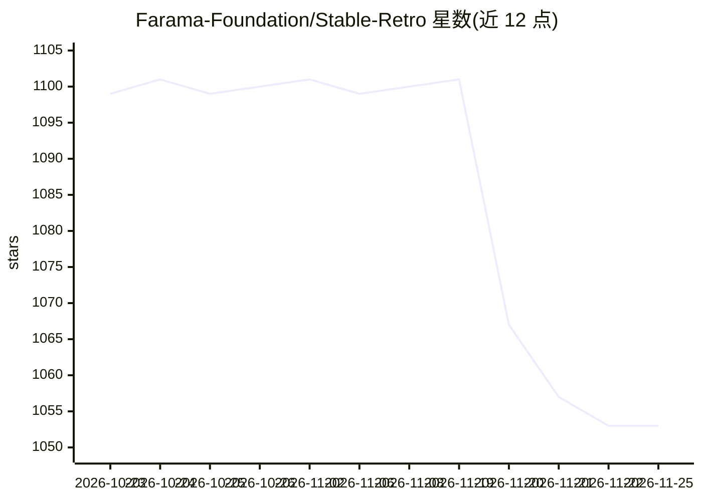

# Farama-Foundation/Stable-Retro

⭐ 1,053 · C++ · MIT · 推送 2026-11-22 · [GitHub](https://github.com/Farama-Foundation/Stable-Retro) · [官网](https://stable-retro.farama.org/) · 组织维护

**为强化学习研究者将复古游戏转为 Gymnasium 环境的库**

gym-retro 的维护分支，将经典电子游戏封装为 Gymnasium 强化学习环境，覆盖 17 类模拟系统（Atari 2600 至 Dreamcast）并集成超过 1000 款游戏。每个游戏整合包含内存变量位置、基于变量的奖励函数、回合结束条件与存档状态；提供整合工具以便为受支持系统添加新游戏。用户需自行提供 ROM（部分平台另需 BIOS），通过脚本按校验和导入。README 给出基于 Stable-Baselines3 PPO 的示例训练流程，文档站点标注为进行中，各核心的许可见 LICENSES.md。

## 筛选速览

| 维度 | 判定 | 备注 |
|---|---|---|
| AI 角色 | `ai-ecosystem` | LLM/agent 周边工具 |
| 许可风险 | `permissive` | MIT |
| 部署形态 | `library` | 以包/库形式分发 |
| 模型依赖 | — | README 未给出锁定关系 |
| 硬件要求 | — | 无带数字的原话,不猜 |
| 安装摩擦 | `medium` | 含编译或系统依赖之一 |
| 成熟度 | — | 结构信号不足 |

## 能力要点

- 集成超过 1000 款复古游戏与 17 类模拟系统
- 每个游戏整合含内存变量、奖励函数与回合结束条件
- 提供向受支持系统添加新游戏的整合工具
- 自带 Airstriker 非商业 ROM 与 PPO 训练示例

## 适用场景

- 在复古游戏环境上训练和评估强化学习算法
- 为新游戏编写环境整合并贡献回上游
- 构建游戏类基准测试 LLM Agent 的多回合环境

## 场景标签

`强化学习` · 领域:训练与推理

## 证据(README 行号)

> L7: A fork of gym-retro ('lets you turn classic video games into Gymnasium environments for reinforcement learning') wit
> L36: ## Supported Games
> L113: Each game integration has files listing memory locations for in-game variables, reward functions based on those va

## 星数曲线

2026-10-23 1,099 → 2026-11-25 1,053（-46）

---
*卡片 v1 · prompt 1.4 · 生成 2026-11-24 · 置信度 mid · 依据 README sha `5f6ed8aaef36` · [字段定义](../../DATASET.md)*
