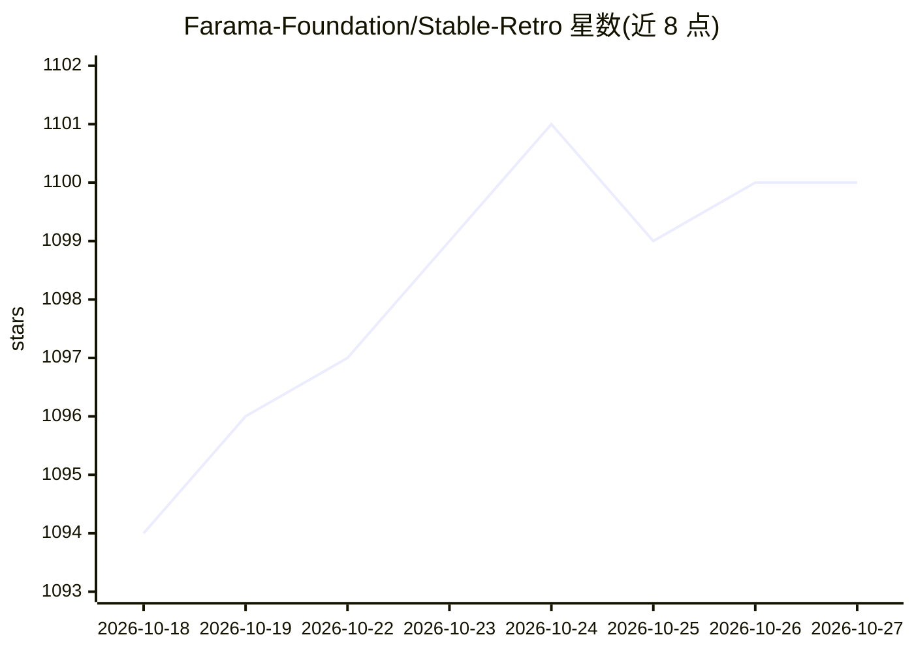

# Farama-Foundation/Stable-Retro

⭐ 1,100 · C++ · MIT · 推送 2026-10-25 · [GitHub](https://github.com/Farama-Foundation/Stable-Retro) · [官网](https://stable-retro.farama.org/) · 组织维护

**经典游戏机模拟器强化学习环境库（Gymnasium 接口）**

gym-retro 的维护性 fork，将 1000 余款经典游戏封装为 Gymnasium 强化学习环境：支持 Atari、NES、SNES、GBA、Sega 系列等 16 类模拟器，跨 Linux/Windows/macOS。每项游戏集成含内存变量位置、奖励函数、回合结束条件与 ROM 哈希校验；ROM 不随库分发，需用户自行获取并通过导入脚本按哈希导入，部分平台还需 BIOS。附带 PPO 训练示例与游戏集成工具。

## 筛选速览

| 维度 | 判定 | 备注 |
|---|---|---|
| AI 角色 | `ai-native` | 本体是模型或模型工具 |
| 许可风险 | `permissive` | MIT |
| 部署形态 | `library` | 以包/库形式分发 |
| 模型依赖 | — | README 未给出锁定关系 |
| 硬件要求 | — | 无带数字的原话,不猜 |
| 安装摩擦 | `high` | 编译与系统依赖俱全 |
| 成熟度 | — | 结构信号不足 |

## 能力要点

- 1000+ 游戏集成为 Gymnasium RL 环境
- 16 类模拟系统（Atari/NES/SNES/N64/DS/Sega 系列等）跨三平台支持
- 游戏集成工具支持自行添加新 ROM/模拟器核心
- 随库附带非商用测试 ROM（Airstriker-Genesis）

## 适用场景

- 在经典游戏上训练强化学习智能体
- 为新的老游戏 ROM 制作 RL 环境集成
- 构建游戏类 RL 基准或研究实验

## 场景标签

`强化学习` · 领域:训练与推理

## 证据(README 行号)

> L7: A fork of gym-retro ('lets you turn classic video games into Gymnasium environments for reinforcement learning') wit
> L86: You need to install a stable baselines 3 version that supports gymnasium

## 星数曲线

2026-10-18 1,094 → 2026-10-27 1,100（+6）

---
*卡片 v1 · prompt 1.4 · 生成 2026-10-21 · 置信度 high · 依据 README sha `05062d0cd4a4` · [字段定义](../../DATASET.md)*
