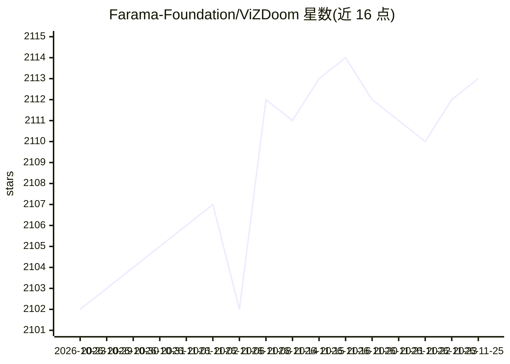

# Farama-Foundation/ViZDoom

⭐ 2,113 · C++ · 推送 2026-11-23 · [GitHub](https://github.com/Farama-Foundation/ViZDoom) · [官网](https://vizdoom.farama.org/) · 组织维护

**基于 Doom 的视觉强化学习研究环境库**

ViZDoom 基于 ZDoom 引擎构建强化学习环境，使 AI bot 仅凭屏幕缓冲等视觉信息玩 Doom，主要面向机器视觉学习与深度强化学习研究。提供 Python（含 Gymnasium/Gym 封装）与 C++ API，支持 Linux/macOS/Windows，具备异步/同步单人与多人模式、深度缓冲与音频缓冲访问、游戏对象自动标注、对局录制等能力，并支持用脚本语言与可视化编辑器创建自定义场景。pip 提供预编译 wheel；无 wheel 平台需从源码构建，依赖 C++11 编译器、CMake、Boost、SDL2。

## 筛选速览

| 维度 | 判定 | 备注 |
|---|---|---|
| AI 角色 | `ai-native` | 本体是模型或模型工具 |
| 许可风险 | `none` | — |
| 部署形态 | `library` | 以包/库形式分发 |
| 模型依赖 | — | README 未给出锁定关系 |
| 硬件要求 | — | 无带数字的原话,不猜 |
| 安装摩擦 | `medium` | 含编译或系统依赖之一 |
| 成熟度 | — | 结构信号不足 |

## 能力要点

- 仅凭屏幕视觉信息训练 AI bot 的强化学习环境
- Python（含 Gymnasium/Gym 封装）与 C++ 双 API
- 同步模式单线程可达 7000 帧/秒，自定义场景工具与示例齐备
- 示例含 PyTorch、TensorFlow、Theano 的学习实现

## 适用场景

- 开展基于视觉的深度强化学习算法研究
- 训练与评测像素输入的智能体 baseline
- 构建自定义 RL 场景或举办竞赛环境

## 场景标签

`强化学习` · 领域:训练与推理

## 证据(README 行号)

> L4: ViZDoom allows developing AI **bots that play Doom using only visual information** (the screen buffer). It is primar
> L11: - API for Python (including Gymnasium/Gym wrappers) and C++,
> L27: ViZDoom API is **reinforcement learning** friendly (suitable also for learning from demonstration, apprenticeship l

## 星数曲线

2026-10-23 2,102 → 2026-11-25 2,113（+11）

---
*卡片 v1 · prompt 1.4 · 生成 2026-11-23 · 置信度 high · 依据 README sha `6e70c9843041` · [字段定义](../../DATASET.md)*
