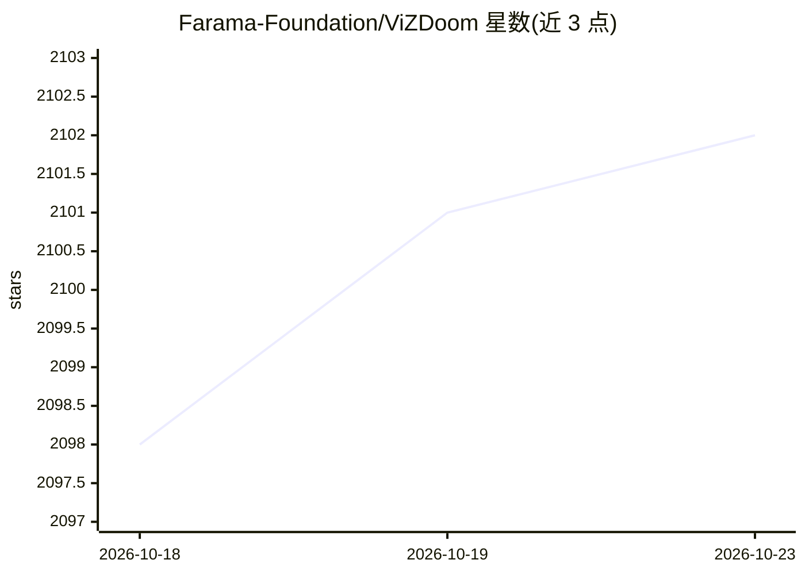

# Farama-Foundation/ViZDoom

⭐ 2,102 · C++ · 推送 2026-10-21 · [GitHub](https://github.com/Farama-Foundation/ViZDoom) · [官网](https://vizdoom.farama.org/) · 组织维护

**基于 Doom 的视觉强化学习研究环境平台**

基于 ZDoom 引擎封装 Doom（默认 Freedoom 资源）的强化学习环境库：AI bot 仅凭屏幕缓冲区（视觉信息）进行决策，提供 Python（含 Gymnasium/Gym 封装）与 C++ 双 API，支持异步/同步、单人/多人模式，可访问深度缓冲、音频缓冲、帧内物体标注、地图几何等状态。附带自定义场景脚本语言与 PyTorch/TensorFlow/Theano 学习示例。主要面向机器视觉学习与深度强化学习研究，pip 安装预编译 wheel，源码构建需 C++11 编译器、CMake 3.12+、Boost、SDL2。

## 筛选速览

| 维度 | 判定 | 备注 |
|---|---|---|
| AI 角色 | `ai-ecosystem` | LLM/agent 周边工具 |
| 许可风险 | `none` | — |
| 部署形态 | `library` | 以包/库形式分发 |
| 模型依赖 | — | README 未给出锁定关系 |
| 硬件要求 | — | 无带数字的原话,不猜 |
| 安装摩擦 | `medium` | 含编译或系统依赖之一 |
| 成熟度 | — | 结构信号不足 |

## 能力要点

- Python 与 C++ 双 API，内置 Gymnasium/Gym 环境封装
- 仅用屏幕缓冲区（视觉信息）驱动 AI bot
- 支持深度缓冲、音频缓冲、自动物体标注、离屏渲染、多人模式
- 通过 ACS 脚本语言与可视化编辑器创建自定义场景

## 适用场景

- 视觉深度强化学习算法的训练与评测
- 从演示学习/学徒学习等 RL 研究实验
- 构建基于 Doom 的导航、泛化、持续学习与安全 RL 基准实验

## 场景标签

`强化学习` `模型评测` · 领域:评测与运维

## 证据(README 行号)

> L4: ViZDoom allows developing AI **bots that play Doom using only visual information** (the screen buffer). It is primar
> L27: ViZDoom API is **reinforcement learning** friendly (suitable also for learning from demonstration, apprenticeship l
> L101: Gymnasium environments are installed along with ViZDoom and are available on all platforms.

## 星数曲线

2026-10-18 2,098 → 2026-10-23 2,102（+4）

---
*卡片 v1 · prompt 1.4 · 生成 2026-10-21 · 置信度 high · 依据 README sha `13807a3c9140` · [字段定义](../../DATASET.md)*
