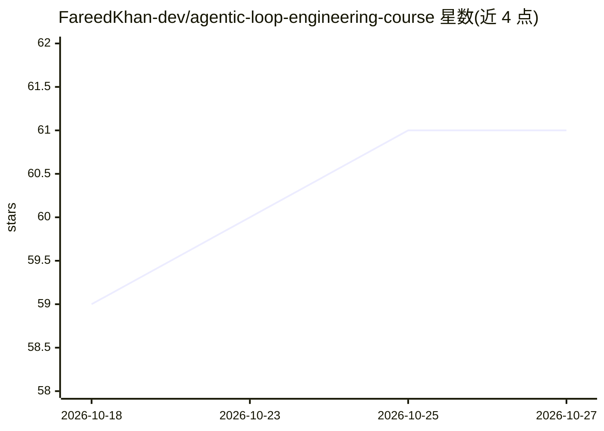

# FareedKhan-dev/agentic-loop-engineering-course

⭐ 61 · Jupyter Notebook · MIT · 推送 2026-06-29 · [GitHub](https://github.com/FareedKhan-dev/agentic-loop-engineering-course) · [官网](https://medium.com/@fareedkhandev/optimizing-agentic-system-using-loop-engineering-7966adad5835) · 个人维护

**18 个 notebook 的 agentic 循环工程课程：逐组件实测**

面向开发者的动手教程仓库：把 agent 循环工程拆为调度、技能/上下文、子代理、记忆检索、worktree、连接器、安全护栏等组件，用 18 个 Jupyter notebook 在 MBPP+、SWE-bench、GitBugs 等真实软件数据集上逐项做基线对比实验，结果可追溯到 results/ 目录的 JSON 文件。模型侧仅需一个 OpenAI 兼容端点，课程在单张 A100 80GB 上以 vLLM 自托管 4bit AWQ 量化的 32B coder 模型完成全部实验；README 同时保留未按预期方向发展的实验结果。安装方式为 venv + pip install -r requirements.txt，notebook 需在仓库根目录启动 Jupyter 运行。

## 筛选速览

| 维度 | 判定 | 备注 |
|---|---|---|
| AI 角色 | `ai-knowledge` | 知识聚合/清单类 |
| 许可风险 | `permissive` | MIT |
| 部署形态 | `library` | 以包/库形式分发 |
| 模型依赖 | local-ok | 支持本地模型 |
| 硬件要求 | — | 无带数字的原话,不猜 |
| 安装摩擦 | `medium` | 含编译或系统依赖之一 |
| 成熟度 | — | 结构信号不足 |

## 能力要点

- 18 个 notebook 覆盖循环工程各组件与 7 种生产模式
- 每项实验给出基线与组件修复后的可复现数值
- 结果均可在 results/*.json 中追溯
- 模型侧仅需 OpenAI 兼容端点，自托管 vLLM + 32B AWQ 量化模型

## 适用场景

- 系统学习 agent 循环工程各组件的作用机制
- 查阅真实数据集上的组件级量化对比结果
- 复现或改造课程中的循环工程实验

## 场景标签

`教程课程` · 领域:学习与行业

## 证据(README 行号)

> L5: A hands-on, fully executed course that isolates **every component of loop engineering** and proves
> L35: Most writing about loops is qualitative. This repository is the opposite. Each notebook takes one

## 星数曲线

2026-10-18 59 → 2026-10-27 61（+2）

---
*卡片 v1 · prompt 1.4 · 生成 2026-10-24 · 置信度 high · 依据 README sha `da39a33eb913` · [字段定义](../../DATASET.md)*
