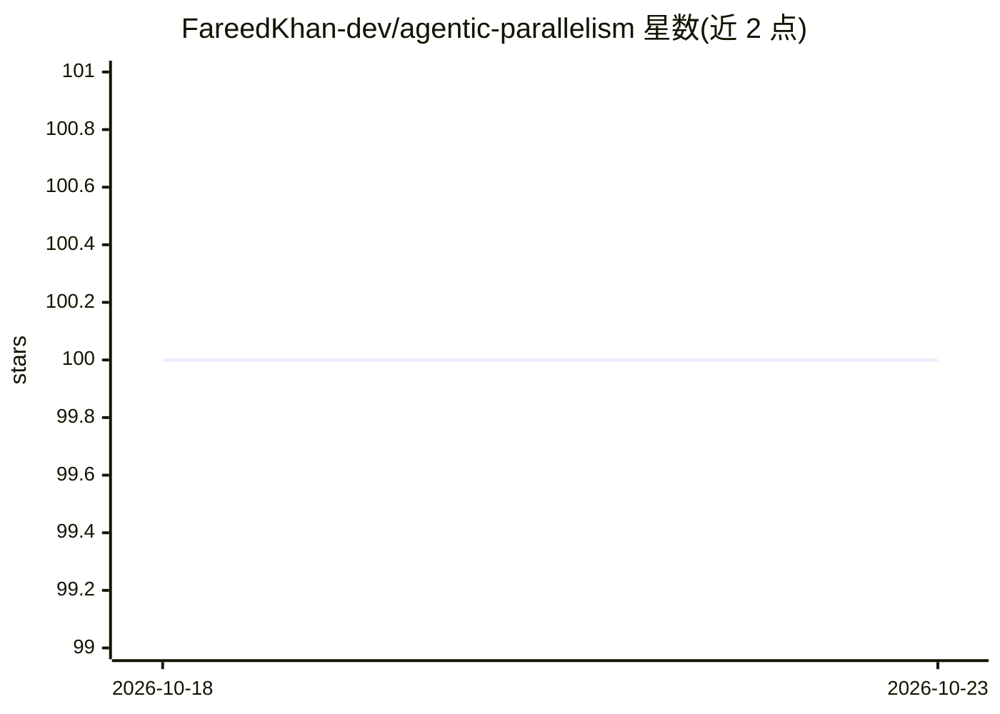

# FareedKhan-dev/agentic-parallelism

⭐ 100 · Jupyter Notebook · MIT · 推送 2025-11-20 · [GitHub](https://github.com/FareedKhan-dev/agentic-parallelism) · [官网](https://medium.com/@fareedkhandev/implementing-14-core-concepts-of-agentic-ai-based-solution-229e50f65986) · 个人维护

**面向开发者的 14 种 Agentic 并行模式示例笔记本集合**

基于 LangChain 与 LangGraph 的 14 个可运行 Jupyter 笔记本，演示 AI agent 系统中的并行化模式，覆盖并行工具调用、并行假设、多 agent 架构（层级团队、竞争集成、流水线、黑板）、冗余执行与 RAG 并行模式（查询扩展、分片检索、混合搜索融合、多跳检索）。每个笔记本自包含并列出各自依赖；技术栈含 Llama 3、Claude 3 Sonnet（Vertex AI）、FAISS、Tavily 与 LangSmith 观测。读者克隆仓库、pip 安装依赖并配置 API key 后运行，配套一篇详解文章。

## 筛选速览

| 维度 | 判定 | 备注 |
|---|---|---|
| AI 角色 | `ai-knowledge` | 知识聚合/清单类 |
| 许可风险 | `permissive` | MIT |
| 部署形态 | `library` | 以包/库形式分发 |
| 模型依赖 | — | README 未给出锁定关系 |
| 硬件要求 | — | 无带数字的原话,不猜 |
| 安装摩擦 | `low` | 无编译、无系统依赖或容器化 |
| 成熟度 | — | 结构信号不足 |

## 能力要点

- 14 个自包含可运行的并行模式笔记本
- 覆盖单 agent、多 agent、可靠性与 RAG 四类模式
- 技术栈含 LangGraph/LangChain/Llama 3/Claude 3 Sonnet/FAISS

## 适用场景

- 学习并复现 agent 系统的并行化设计模式
- 为自建多 agent 或 RAG 系统选型参考架构
- 结合 LangSmith 观测工具调试 agent 行为

## 场景标签

`多智能体` `RAG` `教程课程` · 领域:Agent 开发

## 证据(README 行号)

> L3:  Conceptual based implementations of 14 core patterns for building faster, smarter, and more reliable AI agentic sys
> L11: Welcome to the future of AI agent development! This repository is a comprehensive, hands-on collection of **14 indu

## 星数曲线

2026-10-18 100 → 2026-10-23 100（+0）

---
*卡片 v1 · prompt 1.4 · 生成 2026-10-23 · 置信度 high · 依据 README sha `5d4526701246` · [字段定义](../../DATASET.md)*
