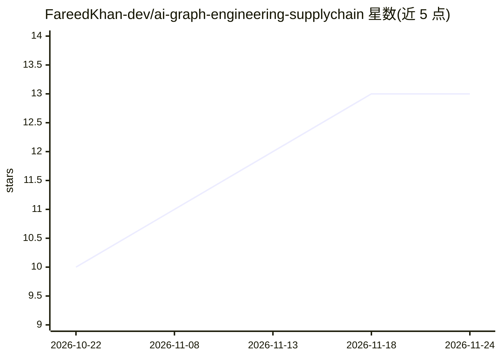

# FareedKhan-dev/ai-graph-engineering-supplychain

⭐ 13 · Python · Apache-2.0 · 推送 2026-09-03 · [GitHub](https://github.com/FareedKhan-dev/ai-graph-engineering-supplychain) · [官网](https://medium.com/@fareedkhandev/graph-engineering-for-supply-chain-cve-exposure-e62658e0c333) · 个人维护

**软件供应链 CVE 暴露图分析库：给出依赖路径与安全修复**

零语言模型调用构建依赖图的分析引擎与教学 notebook：从 lockfile、package.json 与 OSV 受影响范围确定性解析出 8 个包管理器、8,280 万条依赖边，通过七道图谓词门判定某 CVE 是否暴露、经哪条依赖路径可达并给出最小修复集；无可达路径时显式弃权。语言模型仅出现在可选的模型层（语义相关性、GNN、严重性检查），并与独立基准对照评测。以 Python 包与 notebook 形式提供，Apache-2.0 许可，需 Python 3.11+。

## 筛选速览

| 维度 | 判定 | 备注 |
|---|---|---|
| AI 角色 | `ai-enhanced` | 去掉 AI 部分产品仍成立 |
| 许可风险 | `permissive` | Apache-2.0 |
| 部署形态 | `library` | 以包/库形式分发 |
| 模型依赖 | — | README 未给出锁定关系 |
| 硬件要求 | — | 无带数字的原话,不猜 |
| 安装摩擦 | `medium` | 含编译或系统依赖之一 |
| 成熟度 | — | 结构信号不足 |

## 能力要点

- 零 LLM 调用的确定性图构建（446 万包、8,280 万边、28.6 万 advisory）
- 七道门报警阶梯：清除全部门槛的警报携带依赖路径证明，其余带原因抑制
- 修复作为整数规划问题求解最小补丁集，并输出 SBOM 报告
- 可选 GPU 模型层（BGE 嵌入、GraphSAGE、Qwen3-14B 严重性检查）附对照评测

## 适用场景

- 评估组织内 800 个仓库是否受某 CVE 影响并定位依赖路径
- 把 npm audit 的海量告警收敛为带路径证明的短清单
- 在笔记本上完整复现供应链图工程分析流程

## 场景标签

`知识图谱` `网络安全` · 领域:知识与检索

## 证据(README 行号)

> L42: Language models appear only in an optional model layer (semantic relevance, a GNN, an
> L174: |Model layer (optional, GPU)|`embed`, `reach`, `gnn`, `judge`|semantic relevance, a reachability prior, node class

## 星数曲线

2026-10-22 10 → 2026-11-24 13（+3）

---
*卡片 v1 · prompt 1.4 · 生成 2026-11-18 · 置信度 low · 依据 README sha `812232dcf742` · [字段定义](../../DATASET.md)*
