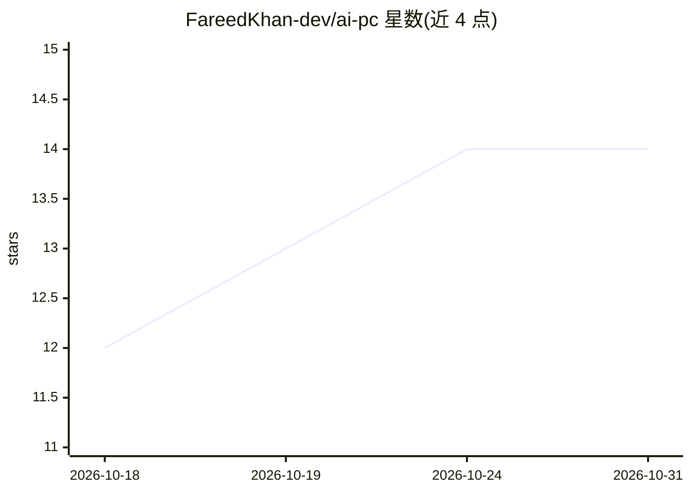

# FareedKhan-dev/ai-pc

⭐ 14 · Python · NOASSERTION · 推送 2026-10-26 · [GitHub](https://github.com/FareedKhan-dev/ai-pc) · 个人维护 · 中文 README

**Windows 桌面 AI 助手：用代码驱动 118 个程序完成任务**

面向 Windows 用户的桌面助手：接收文字或语音请求后，通过读写各程序自身文件格式或调用官方接口（如 python-docx、ezdxf、pyJianYingDraft、kicad-cli、各平台 API）驱动 Word、Excel、剪映、Blender、AutoCAD、KiCad 等 118 个程序与服务在后台完成任务，输出经校验后才回复，每次修改保存为可撤销版本。多数请求由规则处理不调用模型，需要时可接入 25 家模型供应商预设或本地模型（Ollama/LM Studio/llama.cpp/vLLM）。许可证为 all rights reserved。

## 筛选速览

| 维度 | 判定 | 备注 |
|---|---|---|
| AI 角色 | `ai-native` | 本体是模型或模型工具 |
| 许可风险 | `none` | NOASSERTION |
| 部署形态 | `desktop` | 安装包/桌面程序 |
| 模型依赖 | local-ok | 支持本地模型 |
| 硬件要求 | — | 无带数字的原话,不猜 |
| 安装摩擦 | `medium` | 含编译或系统依赖之一 |
| 成熟度 | — | 结构信号不足 |

## 能力要点

- 以文件读写与官方接口驱动 118 个桌面程序与服务，替代截图点击方式
- 输出先经校验（如 Excel 公式 Python 复核、DXF 回读审计）再回复
- 每次修改保存为可撤销的版本
- 25 家模型供应商预设，其中 4 种本地运行（Ollama/LM Studio/llama.cpp/vLLM）

## 适用场景

- 用一句话让 Word/Excel/PowerPoint 生成并校验文档表格演示
- 通过剪映/FFmpeg 后台完成视频剪辑与导出
- 生成 AutoCAD 图纸、Blender 渲染、KiCad 原理图并自动校验
- 经官方 API 发布内容到社交平台（确认后发送）

## 场景标签

`AI 助手` · 领域:对话与助手

## 证据(README 行号)

> L5:  An assistant for Windows that works inside your desktop programs through code.
> L35: You ask in plain words, typed or spoken. AI PC hands the request to the program that can do it: JianYing renders th
> L38: version that "undo" can take back. The few requests that need a language model can use any of 25 providers, or a mo

## 星数曲线

2026-10-18 12 → 2026-10-31 14（+2）

---
*卡片 v1 · prompt 1.4 · 生成 2026-10-31 · 置信度 high · 依据 README sha `a980ba36dd4f` · [字段定义](../../DATASET.md)*
