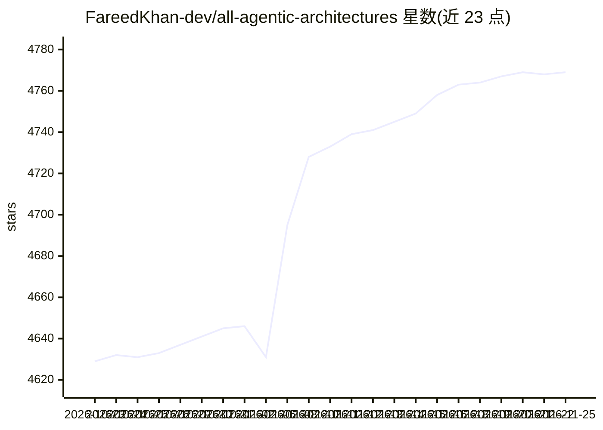

# FareedKhan-dev/all-agentic-architectures

⭐ 4,769 · Jupyter Notebook · MIT · 推送 2026-11-16 · [GitHub](https://github.com/FareedKhan-dev/all-agentic-architectures) · [官网](https://fareedkhan-dev.github.io/all-agentic-architectures/) · 个人维护

**面向开发者的 36 种 agentic AI 架构可运行库与教材**

单个 Python 库，把文献中的 36 种 agentic AI 模式打包为统一 `.run()` 接口的 `Architecture` 类，每个模式附完整执行的 Jupyter notebook。基于 LangGraph 状态机构建，支持 9 家 LLM 提供商切换（`LLM_PROVIDER` 环境变量），并内置 17 任务的基准跑分与排行榜。核心机制为 deterministic-picker 模式：LLM 评分面输出类别特征，由 Python 组合决策信号；无任何 API key 时可用 Ollama 本地模型运行全部架构。MIT 许可。

## 筛选速览

| 维度 | 判定 | 备注 |
|---|---|---|
| AI 角色 | `ai-ecosystem` | LLM/agent 周边工具 |
| 许可风险 | `permissive` | MIT |
| 部署形态 | `library` | 以包/库形式分发 |
| 模型依赖 | local-ok | 支持本地模型 |
| 硬件要求 | — | 无带数字的原话,不猜 |
| 安装摩擦 | `low` | 无编译、无系统依赖或容器化 |
| 成熟度 | — | 结构信号不足 |

## 能力要点

- 36 种架构统一 `Architecture` 接口，同类返回 `ArchitectureResult`
- 9 家提供商通过环境变量切换，无代码改动；支持 Ollama 全本地运行
- 17 任务基准套件输出排行榜（最近一次 33/42 正确）
- 36 个已执行的 notebook，理论讲解基于真实捕获的运行

## 适用场景

- 按学习路径（入门/RAG/多智能体/安全）系统学习 agentic 模式
- 为下游应用挑选并复用某一 agent 架构实现
- 在无 API key 的本地环境验证 agent 模式运行
- 按基准排行榜对比各架构在不同任务上的表现

## 场景标签

`Agent 框架` `多智能体` `RAG` `模型评测` · 领域:Agent 开发

## 证据(README 行号)

> L38: A single Python library that packages every major agentic AI pattern from the literature as a runnable `Architectur
> L55: Same `.run(task)` interface across all 36 architectures. Same `ArchitectureResult` return shape. Swap the class, sw
> L205: ## Benchmarks

## 星数曲线

2026-10-23 4,629 → 2026-11-25 4,769（+140）

---
*卡片 v1 · prompt 1.4 · 生成 2026-11-22 · 置信度 high · 依据 README sha `65a1508a36ed` · [字段定义](../../DATASET.md)*
