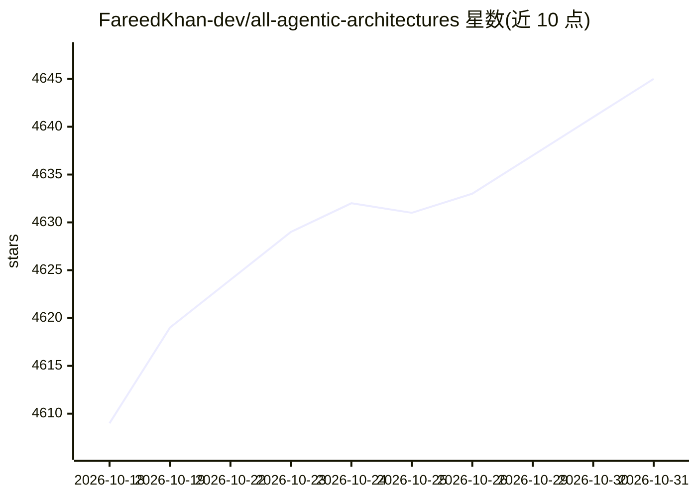

# FareedKhan-dev/all-agentic-architectures

⭐ 4,645 · Jupyter Notebook · MIT · 推送 2026-06-22 · [GitHub](https://github.com/FareedKhan-dev/all-agentic-architectures) · [官网](https://fareedkhan-dev.github.io/all-agentic-architectures/) · 个人维护

**35 种 agentic AI 架构的可运行 Python 库与教科书**

将文献中的 35 种 agentic AI 模式（Reflexion、LATS、GraphRAG、MemGPT、Voyager、BrowserAgent 等）封装为统一契约的 Architecture 类，基于 LangGraph 状态机构建，支持 9 家 LLM 提供商（Nebius/OpenAI/Anthropic/Groq/Ollama/Together/Fireworks/Mistral/Google）通过环境变量切换。每个架构附带实际执行过的 Jupyter notebook，核心机制为确定性选择器模式（LLM 只输出类别特征，Python 组合决策信号）。附带 17 任务基准榜单、283 个通过测试与四条学习路径。

## 筛选速览

| 维度 | 判定 | 备注 |
|---|---|---|
| AI 角色 | `ai-ecosystem` | LLM/agent 周边工具 |
| 许可风险 | `permissive` | MIT |
| 部署形态 | `library` | 以包/库形式分发 |
| 模型依赖 | local-ok | 支持本地模型 |
| 硬件要求 | — | 无带数字的原话,不猜 |
| 安装摩擦 | `low` | 无编译、无系统依赖或容器化 |
| 成熟度 | — | 结构信号不足 |

## 能力要点

- 35 种架构统一 .run(task) 接口与 ArchitectureResult 返回结构
- 9 家 LLM 提供商经 LLM_PROVIDER 环境变量切换，无需改代码
- 确定性选择器模式应用于 13/35 个架构
- 17 任务基准榜单与 283 个通过的测试

## 适用场景

- 学习与对比主流 agentic AI 架构模式的实现
- 在项目中直接复用统一的架构类做原型验证
- 按 RAG/多智能体/安全等学习路径系统入门

## 场景标签

`Agent 框架` `教程课程` `多智能体` · 领域:Agent 开发

## 证据(README 行号)

> L38: A single Python library that packages every major agentic AI pattern from the literature as a runnable `Architectur
> L5: A library *and* a living textbook — real LLM outputs, provider-agnostic,

## 星数曲线

2026-10-18 4,609 → 2026-10-31 4,645（+36）

---
*卡片 v1 · prompt 1.4 · 生成 2026-10-20 · 置信度 high · 依据 README sha `3f5e76a4605c` · [字段定义](../../DATASET.md)*
