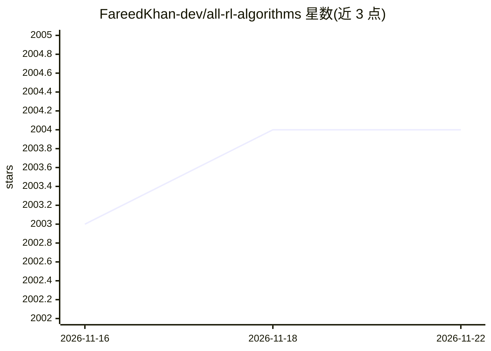

# FareedKhan-dev/all-rl-algorithms

⭐ 2,004 · Jupyter Notebook · MIT · 推送 2026-11-16 · [GitHub](https://github.com/FareedKhan-dev/all-rl-algorithms) · 个人维护

**强化学习算法的教学性 Notebook 实现集合（19 个算法）**

以教育为目的的 Python 仓库，用 Jupyter Notebook 从零实现 19 种强化学习算法，覆盖 Q-Learning、SARSA、DQN、PPO、A2C/A3C、DDPG、SAC、TRPO、MADDPG、QMIX、HAC、MCTS、PlaNet 及多臂老虎机动态定价等，仅依赖 NumPy/Matplotlib/PyTorch 等基础库，代码以可读性优先而非性能优化。附带汇总核心概念、公式与伪代码的 RL Cheat Sheet。部分算法（PlaNet、HAC、MADDPG）做了简化处理并在文档中注明。安装需 clone 仓库后用 uv sync 或 pip 安装依赖并运行 Jupyter。

## 筛选速览

| 维度 | 判定 | 备注 |
|---|---|---|
| AI 角色 | `ai-knowledge` | 知识聚合/清单类 |
| 许可风险 | `permissive` | MIT |
| 部署形态 | `library` | 以包/库形式分发 |
| 模型依赖 | — | README 未给出锁定关系 |
| 硬件要求 | — | 无带数字的原话,不猜 |
| 安装摩擦 | `low` | 无编译、无系统依赖或容器化 |
| 成熟度 | — | 结构信号不足 |

## 能力要点

- 19 种 RL 算法的分 Notebook 实现（从表格方法到 MARL 与规划）
- 附带覆盖概念、公式、伪代码的 RL Cheat Sheet
- 每个 Notebook 含学习曲线、Q 表热图、策略网格等可视化
- 含测试与 CI，验证 Notebook 顺序运行与算法行为

## 适用场景

- 系统学习强化学习算法的原理与实现细节
- 通过修改超参数和环境做交互式实验
- 快速查阅 RL 算法公式与伪代码速查表

## 场景标签

`强化学习` `教程课程` · 领域:学习与行业

## 证据(README 行号)

> L15: This repository is a collection of Python implementations of various Reinforcement Learning (RL) algorithms. The *p
> L19: **This is *not* a performance-optimized library!** I prioritize readability and clarity over speed and advanced fea

## 星数曲线

2026-11-16 2,003 → 2026-11-22 2,004（+1）

---
*卡片 v1 · prompt 1.4 · 生成 2026-11-17 · 置信度 mid · 依据 README sha `df5adf7bd636` · [字段定义](../../DATASET.md)*
