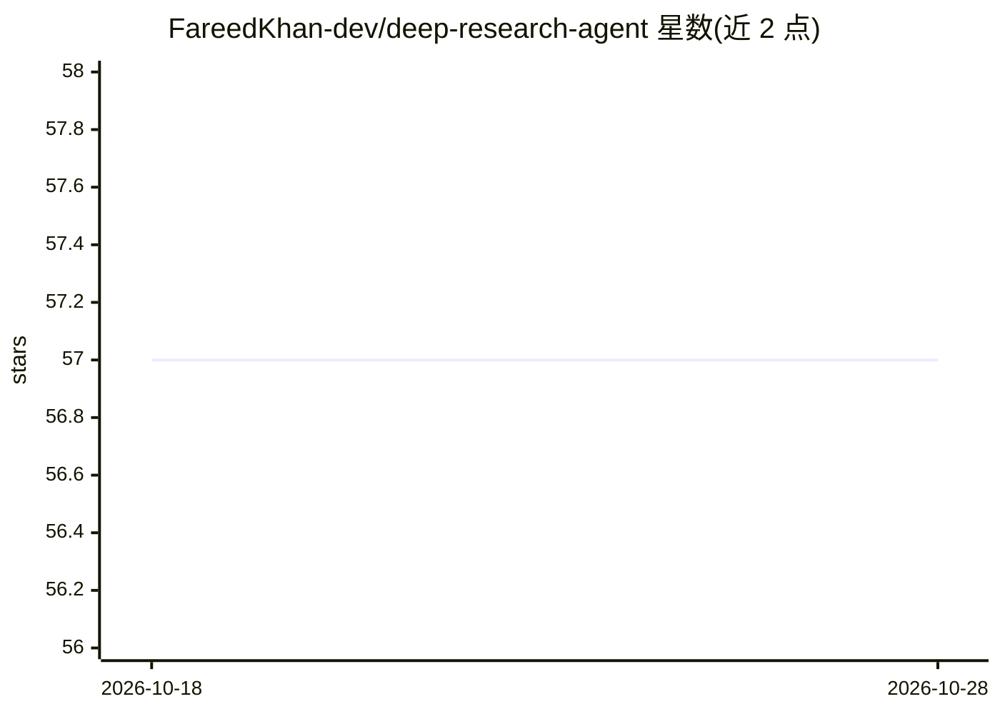

# FareedKhan-dev/deep-research-agent

⭐ 57 · Jupyter Notebook · MIT · 推送 2025-12-11 · [GitHub](https://github.com/FareedKhan-dev/deep-research-agent) · [官网](https://medium.com/@fareedkhandev/building-deep-research-agent-using-time-noise-diffusion-algorithm-587ed3c225a0) · 个人维护

**教程博客：讲解如何用 LangGraph 构建深度研究 Agent**

以博客形式逐步讲解实现 Time-Tested Diffusion based Deep Research（TTD-DR）架构的深度研究 Agent：通过分层状态（Pydantic/TypedDict 定义的 Fact、Critique、QualityMetric、SupervisorState）管理多智能体协作，Supervisor 调度并行 worker 研究子课题，Red Team 批判与 Evaluator 评分形成自我修正循环，逐轮'去噪'精炼报告。代码基于 LangChain/LangGraph 工具与子图机制，全文以讲解为主，完整代码在作者 GitHub 仓库，README 中未见安装命令。

## 筛选速览

| 维度 | 判定 | 备注 |
|---|---|---|
| AI 角色 | `ai-knowledge` | 知识聚合/清单类 |
| 许可风险 | `permissive` | MIT |
| 部署形态 | `None` |  |
| 模型依赖 | — | README 未给出锁定关系 |
| 硬件要求 | — | 无带数字的原话,不猜 |
| 安装摩擦 | `low` | 无编译、无系统依赖或容器化 |
| 成熟度 | — | 结构信号不足 |

## 能力要点

- 分层状态结构：Fact 含 source_url、confidence_score 与 is_disputed 标记
- Supervisor 委派并行 worker 研究、Red Team 对抗批判、Evaluator 评分的迭代精炼循环
- ConductResearch/ResearchComplete/think_tool 等工具基于 LangChain/LangGraph 实现
- quality_history 记录每轮质量快照，用于诊断精炼是否收敛

## 适用场景

- 学习多智能体深度研究系统的架构设计
- 参考分层状态与对抗式自我修正循环的实现方式
- 作为构建自己的 LangGraph 研究 Agent 的代码参考

## 场景标签

`教程课程` `多智能体` · 领域:Agent 开发

## 证据(README 行号)

> L1: # Building Deep Research Agent
> L22: In this blog, we are going to implement this architecture and visually understand each of its components step by st

## 星数曲线

2026-10-18 57 → 2026-10-28 57（+0）

---
*卡片 v1 · prompt 1.4 · 生成 2026-10-24 · 置信度 high · 依据 README sha `e6b8b15c2301` · [字段定义](../../DATASET.md)*
