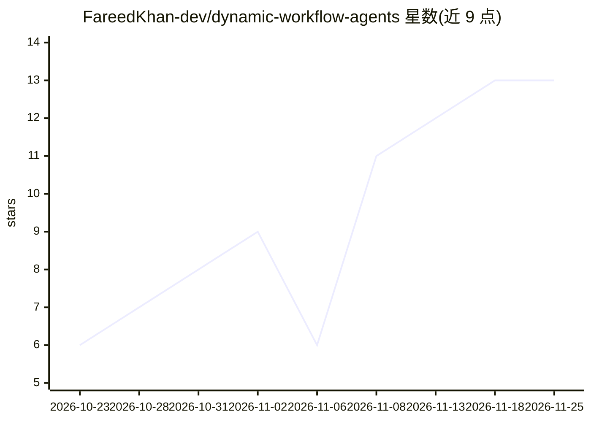

# FareedKhan-dev/dynamic-workflow-agents

⭐ 13 · Jupyter Notebook · 推送 2026-10-16 · [GitHub](https://github.com/FareedKhan-dev/dynamic-workflow-agents) · 个人维护

**从零构建多智能体工作流运行时的教程笔记本（Claude/Qwen 双版本）**

包含两个自足的笔记本版本，教学内容为从零实现一个多智能体运行时：主控 agent 编写分阶段计划，纯 Python 运行时以并行 worker 执行，带事件、线程、共享预算与恢复机制。核心实验是在植入 72 个 bug 的算法库上做审计，比较单 agent、固定工作流与动态工作流三种设计；另有数学作业评分与客户消息聚类两个任务。每次模型调用按请求键入答案账本，可离线回放而无需重新付费。需 Python 3.11+ 与 uv，运行 Claude 版需 ANTHROPIC key，Qwen 版需 ModelScope key。

## 筛选速览

| 维度 | 判定 | 备注 |
|---|---|---|
| AI 角色 | `ai-knowledge` | 知识聚合/清单类 |
| 许可风险 | `none` | — |
| 部署形态 | `None` |  |
| 模型依赖 | — | README 未给出锁定关系 |
| 硬件要求 | — | 无带数字的原话,不猜 |
| 安装摩擦 | `low` | 无编译、无系统依赖或容器化 |
| 成熟度 | — | 结构信号不足 |

## 能力要点

- lead 写计划、纯 Python 运行时并行执行的动态工作流实现
- 答案账本（ledger）支持已付费调用的离线回放
- 72 植入 bug 的审计基准与三臂对比实验
- smoke/replay/collect 三种运行模式区分成本与证据

## 适用场景

- 学习如何从零实现多智能体并行运行时与调度预算
- 在可复验基准上比较单 agent、固定与动态工作流设计
- 复用账本数据离线回放实验而不产生模型费用

## 场景标签

`教程课程` `多智能体` · 领域:Agent 开发

## 证据(README 行号)

> L11: This repository contains two self-contained editions of **Dynamic Workflows from Scratch**. In each notebook, a lea
> L44: The notebook teaches the pieces in sequence: create a verifiable benchmark, implement the model client and ledger, 
> L86: Install **Python 3.11+** and uv. Clone the private repository, choose an edition, and install its locked dependenci

## 星数曲线

2026-10-23 6 → 2026-11-25 13（+7）

---
*卡片 v1 · prompt 1.4 · 生成 2026-11-18 · 置信度 high · 依据 README sha `df3eec068d2d` · [字段定义](../../DATASET.md)*
