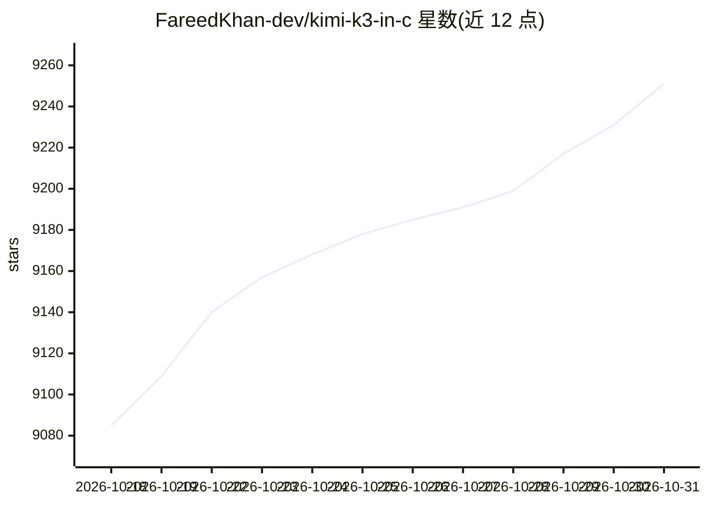

# FareedKhan-dev/kimi-k3-in-c

⭐ 9,251 · C · Apache-2.0 · 推送 2026-10-02 · [GitHub](https://github.com/FareedKhan-dev/kimi-k3-in-c) · [官网](https://medium.com/@fareedkhandev/building-kimi-k3-in-c-to-run-a-2-8t-model-on-consumer-hardware-a5792cbf3b59) · 个人维护

**纯 C99 在单 CPU/8GB 内存上运行 Kimi K3 的推理引擎**

从零实现的可移植 C99 推理引擎，在无 BLAS、无框架、无 GPU 条件下运行 2.78 万亿参数的 Kimi K3 模型：稠密主干驻留内存并按需从 NVMe 流式读取，1.45 TB 路由专家以 4-bit 打包形式直接从磁盘计算，峰值内存 8.24 GB，输出与全量内存运行字节一致。面向希望在本机消费级硬件上复现大模型推理的开发者。限制：checkpoint 达 1.56 TB（磁盘门槛约 1.7 TB），8 GB 机器上每 token 需数十秒，属可运行而非交互速度。

## 筛选速览

| 维度 | 判定 | 备注 |
|---|---|---|
| AI 角色 | `ai-native` | 本体是模型或模型工具 |
| 许可风险 | `permissive` | Apache-2.0 |
| 部署形态 | `None` |  |
| 模型依赖 | — | README 未给出锁定关系 |
| 硬件要求 | `cpu-ok` | |
| 安装摩擦 | `medium` | 含编译或系统依赖之一 |
| 成熟度 | — | 结构信号不足 |

## 能力要点

- C99 实现，无 BLAS/框架/GPU，引擎约 176 KB
- 8.24 GB 峰值内存运行 2.78T 参数模型，输出字节一致
- 稠密主干打包（109 GB）+ 专家流式读取，内存预算可调
- make test 无需 checkpoint 即可运行端到端参考对照测试

## 适用场景

- 在普通笔记本 8 GB 内存上运行超大规模 MoE 模型
- 学习从零构建 LLM 推理引擎的各组件实现
- 研究内存受限条件下的大模型流式推理

## 场景标签

`推理引擎` · 领域:训练与推理

## 证据(README 行号)

> L3:  A 2.78-trillion-parameter model. One CPU. 8 GB of RAM.
> L5:  Kimi K3 inference in portable C99. No BLAS. No framework. No GPU.

## 星数曲线

2026-10-18 9,085 → 2026-10-31 9,251（+166）

---
*卡片 v1 · prompt 1.4 · 生成 2026-10-20 · 置信度 high · 依据 README sha `ef678a7aa853` · [字段定义](../../DATASET.md)*
