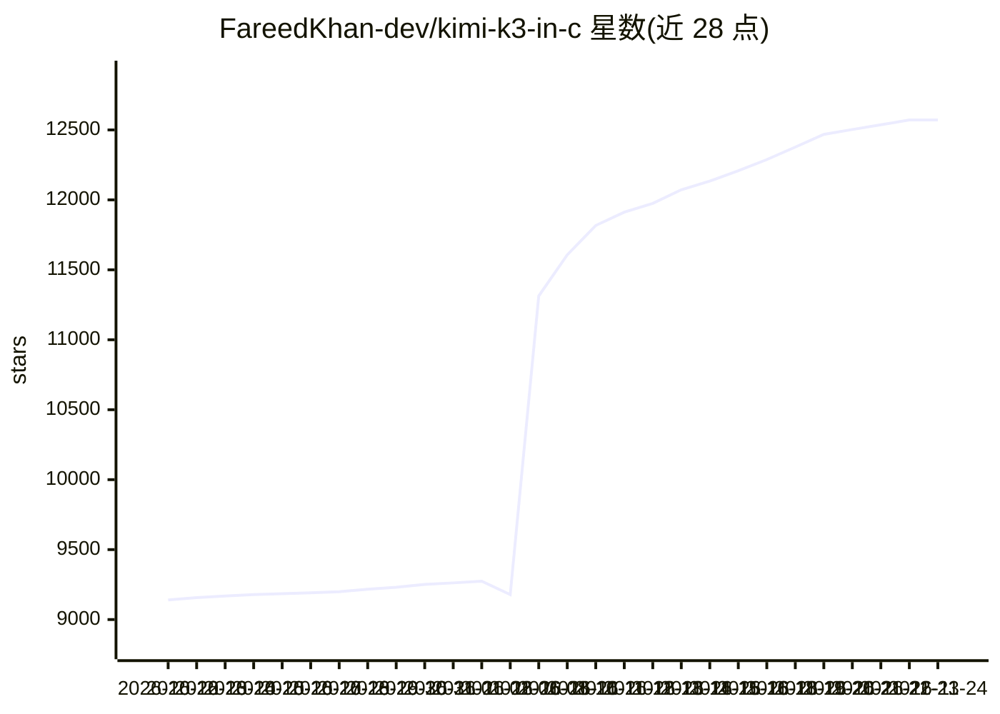

# FareedKhan-dev/kimi-k3-in-c

⭐ 12,620 · C · Apache-2.0 · 推送 2026-11-16 · [GitHub](https://github.com/FareedKhan-dev/kimi-k3-in-c) · [官网](https://medium.com/@fareedkhandev/building-kimi-k3-in-c-to-run-a-2-8t-model-on-consumer-hardware-a5792cbf3b59) · 个人维护

**单 CPU、低内存下以纯 C99 运行 Kimi K2 671B 推理**

从零实现的 C99 推理引擎，读取 Kimi K2 671B 的 safetensors 分片，在纯 CPU（无 GPU、无 BLAS、无框架）上执行文本生成。核心机制：将 61 个稀疏 MoE 层打包为连续的 trunk.bin，按层流式 mmap+read 读取，配合 LRU 专家缓存、双缓冲流水线、GEMV 与在线激活量化（恩典量化）将常驻内存压到 2.4-380 GB 多档。依赖仅需 C99 编译器与 OpenMP。提供 python 下载/打包/多轮 chat 脚本；git 历史声称从单文件逐步构建，但仓库实际从 v2.0.0 起步，早期目录仅在压缩包中提供。

## 筛选速览

| 维度 | 判定 | 备注 |
|---|---|---|
| AI 角色 | `ai-native` | 本体是模型或模型工具 |
| 许可风险 | `permissive` | Apache-2.0 |
| 部署形态 | `None` |  |
| 模型依赖 | — | README 未给出锁定关系 |
| 硬件要求 | `cpu-ok` | |
| 安装摩擦 | `medium` | 含编译或系统依赖之一 |
| 成熟度 | — | 结构信号不足 |

## 能力要点

- 纯 C99 实现的 671B MoE 模型 CPU 推理，无 BLAS/GPU/框架依赖
- trunk.bin 层级内存映射 + LRU 专家缓存 + 双缓冲流水线的流式推理
- 恩典量化（在线激活量化）支持 2.4/3.8/7.5/13/19/30/64/113.5/380 GB 多档内存 preset
- 仅依赖 C99 编译器与 OpenMP，约 5000 行源码

## 适用场景

- 在没有 GPU 的普通电脑上本地运行 Kimi K2 生成文本
- 在有限内存机器上通过小 preset 体验 671B 模型
- 学习 MoE 推理引擎的底层 C 实现

## 场景标签

`推理引擎` `模型量化` · 领域:训练与推理

## 证据(README 行号)

> L1: kimi-k3-in-c
> L3:  A 2.78-trillion-parameter model. One CPU. 8 GB of RAM.

## 星数曲线

2026-10-22 9,140 → 2026-11-24 12,571（+3,431）

---
*卡片 v1 · prompt 1.4 · 生成 2026-11-22 · 置信度 high · 依据 README sha `c93aeceec8b8` · [字段定义](../../DATASET.md)*
