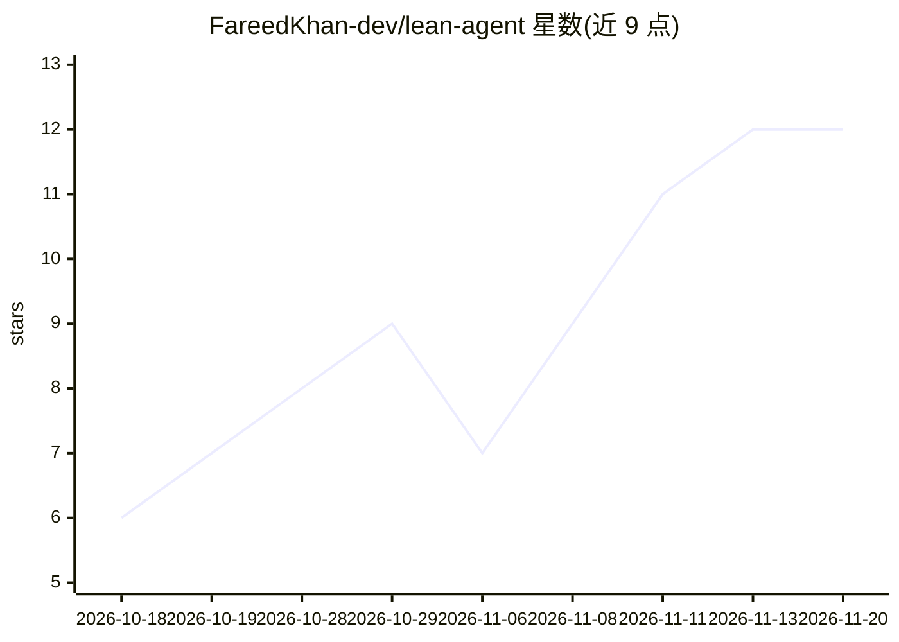

# FareedKhan-dev/lean-agent

⭐ 12 · Jupyter Notebook · 推送 2026-10-07 · [GitHub](https://github.com/FareedKhan-dev/lean-agent) · [官网](https://medium.com/@fareedkhandev/fixing-over-engineering-in-llm-coding-agents-12e31ec83e9b) · 个人维护

**一个以课程笔记本形式交付、抑制过度工程化倾向的编码 Agent**

单个 Jupyter 笔记本（约 1,600 个单元格，含 24 张图与 37 张示意图）从零构建一个编码 Agent：host/plugin/lab 三层结构，通过规则阶梯、钩子注入、critic 审查等机制抑制模型过度工程化。附预注册实验（340 episodes、5 臂、6 个模型）验证效果，并给出否定结果。支持 smoke/replay/collect 三种运行模式，replay 无需 API key 即可离线复现；还提供 run_on_folder 在用户自己的代码上产出补丁。

## 筛选速览

| 维度 | 判定 | 备注 |
|---|---|---|
| AI 角色 | `ai-knowledge` | 知识聚合/清单类 |
| 许可风险 | `none` | — |
| 部署形态 | `library` | 以包/库形式分发 |
| 模型依赖 | — | README 未给出锁定关系 |
| 硬件要求 | — | 无带数字的原话,不猜 |
| 安装摩擦 | `low` | 无编译、无系统依赖或容器化 |
| 成熟度 | — | 结构信号不足 |

## 能力要点

- 单笔记本从零构建 Agent，含 bloat meter、34 个带隐藏测试的任务与沙箱
- 预注册实验设计，提交的实验记录可复现（replay 模式免费、无需 API key）
- smoke/replay/collect 三种运行模式，collect 含每日调用上限与自检门槛
- run_on_folder 以只读方式处理用户目录并返回 git apply 可用的补丁

## 适用场景

- 学习编码 Agent 的完整实现与实验评测方法
- 离线复现论文级实验结果而无需付费调用 API
- 在自己的项目工单上运行该 Agent 并获得补丁与报告

## 场景标签

`编码 Agent` `模型评测` `教程课程` · 领域:编码与开发

## 证据(README 行号)

> L3: **A coding agent that refuses to over-engineer, built from scratch and measured honestly, in one course notebook.**
> L7: Everything lives in one notebook, `lean_agent_course.ipynb`: about 1,600 cells, one function per cell, each explaine
> L21: |**III. The host**|A streaming API client in the standard library, a ledger that caches and replays every model ans

## 星数曲线

2026-10-18 6 → 2026-11-20 12（+6）

---
*卡片 v1 · prompt 1.4 · 生成 2026-11-18 · 置信度 mid · 依据 README sha `85a44d9b0e09` · [字段定义](../../DATASET.md)*
