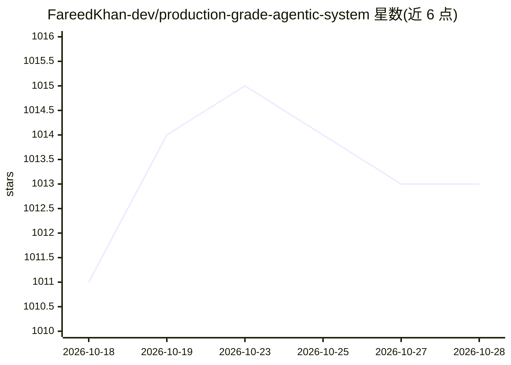

# FareedKhan-dev/production-grade-agentic-system

⭐ 1,015 · Python · MIT · 推送 2025-12-18 · [GitHub](https://github.com/FareedKhan-dev/production-grade-agentic-system) · [官网](https://medium.com/@fareedkhandev/building-a-critical-infrastructure-for-production-ready-ai-agentic-system-building-a-production-37ee5d941f1c) · 个人维护

**教程/模板：逐层构建生产级 agentic AI 系统的架构指南**

以博客式 README 逐步讲解如何搭建面向生产的多智能体系统：从模块化目录结构、pyproject.toml 依赖管理、多环境 .env 配置（development/staging/production）、Pydantic Settings 加载，到后续各架构层（编排、记忆、安全、可观测、容错）。技术栈包含 OpenAI 作为主 LLM 提供方、Langfuse 做可观测、PostgreSQL 数据库、SlowAPI 限流、Grafana/Prometheus 监控。给想在自己基础设施上部署 AI agent 的开发团队参考，README 提供克隆命令但主体是讲解而非完整可运行产品。

## 筛选速览

| 维度 | 判定 | 备注 |
|---|---|---|
| AI 角色 | `ai-ecosystem` | LLM/agent 周边工具 |
| 许可风险 | `permissive` | MIT |
| 部署形态 | `self-host` | docker 或自建部署 |
| 模型依赖 | — | README 未给出锁定关系 |
| 硬件要求 | — | 无带数字的原话,不猜 |
| 安装摩擦 | `low` | 无编译、无系统依赖或容器化 |
| 成熟度 | — | 结构信号不足 |

## 能力要点

- 覆盖依赖、配置、限流、认证、可观测等生产层组件的搭建讲解
- 多环境 .env（development/staging/production）+ Pydantic Settings 配置方案
- 使用 OpenAI 为主 LLM 提供方，Langfuse 做 LLM 可观测
- 面向 ≤10K 活跃用户的 agentic 系统规模设定

## 适用场景

- 学习生产级多智能体系统的分层架构与工程实践
- 参考模块化代码结构与配置管理搭建自己的 agent 后端
- 了解依赖管理、限流、监控在生产 AI 系统中的组织方式

## 场景标签

`教程课程` · 领域:学习与行业

## 证据(README 行号)

> L3: Modern **agentic AI systems**, whether running in **development, staging, or production**, are built as a **set of w
> L15: In this blog, we will build all the core architectural layers needed to deploy a production-ready agentic system, *
> L68: Since we are building an agentic AI system (For ≤10K users actively using our agent), we need a range of libraries 

## 星数曲线

2026-10-18 1,011 → 2026-10-28 1,013（+2）

---
*卡片 v1 · prompt 1.4 · 生成 2026-10-21 · 置信度 mid · 依据 README sha `32e1fa57654f` · [字段定义](../../DATASET.md)*
