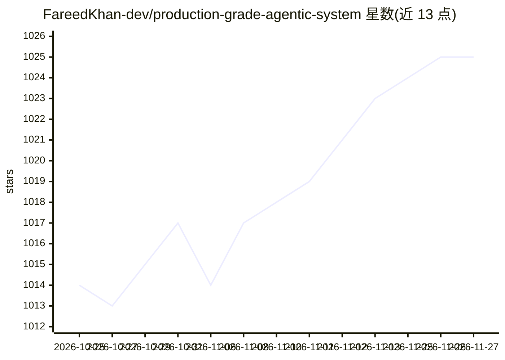

# FareedKhan-dev/production-grade-agentic-system

⭐ 1,025 · Python · MIT · 推送 2026-11-16 · [GitHub](https://github.com/FareedKhan-dev/production-grade-agentic-system) · [官网](https://medium.com/@fareedkhandev/building-a-critical-infrastructure-for-production-ready-ai-agentic-system-building-a-production-37ee5d941f1c) · 个人维护

**构建生产级 Agentic AI 系统的分层架构教程工程**

以博客/教程形式逐层构建一个生产级 agentic AI 系统的代码仓库，覆盖 agent 编排、记忆管理、安全控制、可观测性与故障处理等架构层，监控 agent 行为（推理准确性、工具调用、记忆一致性）与系统可靠性（延迟、吞吐、成本）。工程上采用模块化 src/ 目录、pyproject.toml 依赖管理（含版本上限与 uv.lock 锁定）、多环境 .env 配置、JWT 认证、PostgreSQL 连接池与速率限制。代码清单经过精简，以 src/ 下完整文件为参考。

## 筛选速览

| 维度 | 判定 | 备注 |
|---|---|---|
| AI 角色 | `ai-ecosystem` | LLM/agent 周边工具 |
| 许可风险 | `permissive` | MIT |
| 部署形态 | `self-host` | docker 或自建部署 |
| 模型依赖 | — | README 未给出锁定关系 |
| 硬件要求 | — | 无带数字的原话,不猜 |
| 安装摩擦 | `low` | 无编译、无系统依赖或容器化 |
| 成熟度 | — | 结构信号不足 |

## 能力要点

- 7 层生产级 agentic 系统架构，含编排、记忆、安全、可观测性
- pyproject.toml + uv.lock 依赖锁定与多环境 .env 配置管理
- Langfuse 用于 LLM 交互监控，Grafana/Prometheus 用于系统监控
- JWT 密钥强制校验、连接池与速率限制等工程化机制

## 适用场景

- 团队在自己的基础设施中部署 AI agent 时参考其分层架构
- 为 agentic 项目搭建模块化代码结构与依赖管理规范
- 需要 JWT 认证、限流、监控等生产化配置的 agent API 工程

## 场景标签

`教程课程` · 领域:学习与行业

## 证据(README 行号)

> L3: Modern **agentic AI systems**, whether running in **development, staging, or production**, are built as a **set of w
> L15: In this blog, we will build all the core architectural layers needed to deploy a production-ready agentic system, *
> L169: We are going to use `OpenAI` as our primary LLM provider so we need to set the API key, default model, and tempera

## 星数曲线

2026-10-25 1,014 → 2026-11-27 1,025（+11）

---
*卡片 v1 · prompt 1.4 · 生成 2026-11-24 · 置信度 mid · 依据 README sha `96249eca1e82` · [字段定义](../../DATASET.md)*
