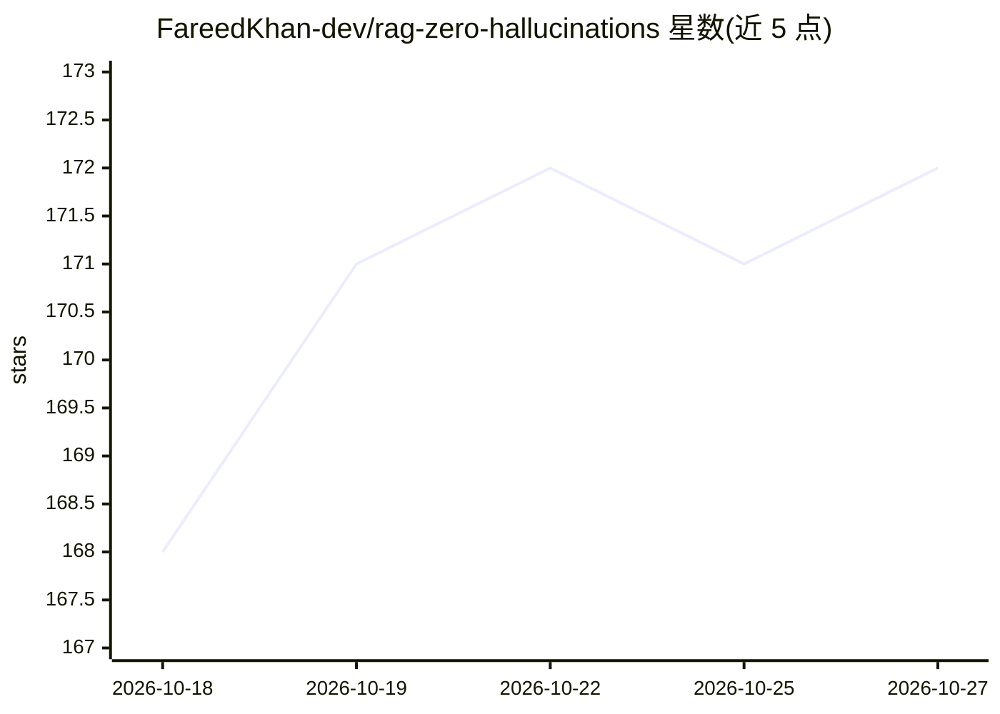

# FareedKhan-dev/rag-zero-hallucinations

⭐ 172 · Jupyter Notebook · MIT · 推送 2026-06-08 · [GitHub](https://github.com/FareedKhan-dev/rag-zero-hallucinations) · 个人维护

**教程：构建千万级文档、低幻觉并带引用的 RAG 管线**

由 Fareed Khan 编写的分步教程（notebook 形式），讲解如何搭建面向 10M+ 文档规模、以降低幻觉为目标的 RAG 管线。流程覆盖语料清洗与 MinHash LSH 去重、LanceDB 稠密向量加 BM25 稀疏索引的混合检索、RRF 融合与重排、问题分解路由、带引用的受约束生成、原子声明逐条核验与校准弃答，并以 CRAG 自纠环串联。全链路使用本地 Qwen3 开放权重模型，生成器经独立 vLLM 服务接入。评测基于 HotpotQA、SQuAD v2 不可回答集与 HaluBench。

## 筛选速览

| 维度 | 判定 | 备注 |
|---|---|---|
| AI 角色 | `ai-knowledge` | 知识聚合/清单类 |
| 许可风险 | `permissive` | MIT |
| 部署形态 | `None` |  |
| 模型依赖 | local-ok | 支持本地模型 |
| 硬件要求 | — | 无带数字的原话,不猜 |
| 安装摩擦 | `medium` | 含编译或系统依赖之一 |
| 成熟度 | — | 结构信号不足 |

## 能力要点

- 稠密（LanceDB）+ 稀疏（BM25）混合索引，RRF 融合后重排
- 逐句引用、原子声明 faithfulness 核验与校准弃答机制
- 全部模型为本地开放权重 Qwen3，数据不出机器
- 以 HotpotQA/SQuAD v2/HaluBench 三数据集分别测检索、幻觉与核验器

## 适用场景

- 学习大规模低幻觉 RAG 管线的完整构建方法
- 在私有语料上复现可引用、可弃答的问答管线
- 参考混合检索与声明级核验的评测设计

## 场景标签

`RAG` `教程课程` · 领域:知识与检索

## 证据(README 行号)

> L1: # Building a RAG Pipeline for 10M+ Documents With Near-Zero Hallucination
> L8: Here is everything the pipeline contains, and we build it top to bottom, one component at a time:
> L18: * **Wire the agent**: connect it all into a self-correcting CRAG loop that re-retrieves on weak evidence.

## 星数曲线

2026-10-18 168 → 2026-10-27 172（+4）

---
*卡片 v1 · prompt 1.4 · 生成 2026-10-22 · 置信度 high · 依据 README sha `ea742857925f` · [字段定义](../../DATASET.md)*
