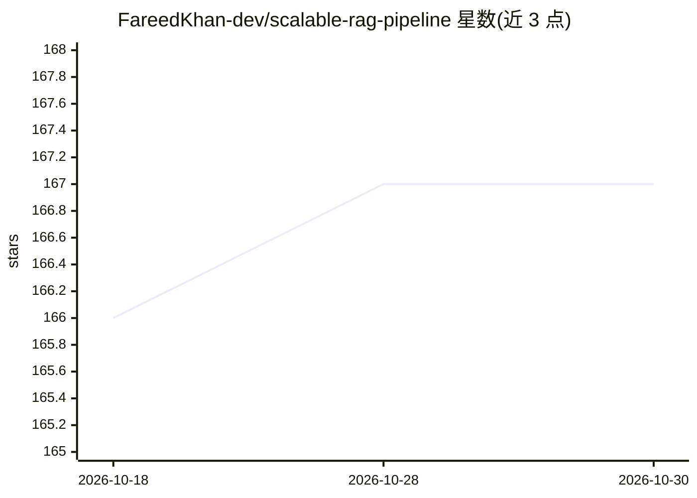

# FareedKhan-dev/scalable-rag-pipeline

⭐ 167 · Python · MIT · 推送 2025-12-27 · [GitHub](https://github.com/FareedKhan-dev/scalable-rag-pipeline) · [官网](https://medium.com/@fareedkhandev/1168dcd36260) · 个人维护

**AWS EKS 上的生产级 Agentic RAG 平台：Terraform+Ray+混合检索**

面向生产部署的 Agentic RAG 系统源码与基础设施代码：用 Terraform 在 AWS 上供给 VPC/EKS/RDS/S3，以 Karpenter 自动伸缩 CPU 与 GPU（g5/A10G）节点，通过 KubeRay 与 Ray Serve 部署 BGE-M3 嵌入服务和 vLLM Llama-3-70B 推理服务；检索层结合 Qdrant 向量搜索与 Neo4j 图搜索，用 LangGraph 建模规划、查询改写与 HyDE。部署流程为多阶段（Terraform→集群引导→数据面→API→数据摄取），要求 AWS CLI、Terraform、kubectl、Helm、Docker 等前置工具。

## 筛选速览

| 维度 | 判定 | 备注 |
|---|---|---|
| AI 角色 | `ai-ecosystem` | LLM/agent 周边工具 |
| 许可风险 | `permissive` | MIT |
| 部署形态 | `None` |  |
| 模型依赖 | local-ok | 支持本地模型 |
| 硬件要求 | — | 无带数字的原话,不猜 |
| 安装摩擦 | `low` | 无编译、无系统依赖或容器化 |
| 成熟度 | — | 结构信号不足 |

## 能力要点

- LangGraph 状态机式多步推理（规划节点、查询改写、HyDE）
- 向量（Qdrant/BGE-M3）+ 知识图谱（Neo4j/Cypher）混合检索
- Ray 分布式编排，Karpenter GPU 节点 Spot 实例与 Scale-to-Zero 成本控制
- Terraform IaC 全流程供给 EKS/RDS/S3 等资源

## 适用场景

- 在 AWS 上从零部署生产级 Agentic RAG 问答系统
- 搭建向量+图谱混合检索的知识库并接入企业文档
- 参考云原生 GPU 推理集群的弹性伸缩与成本优化方案

## 场景标签

`RAG` `Agent 框架` · 领域:Agent 开发

## 证据(README 行号)

> L12: This repository contains the source code and Infrastructure-as-Code (IaC) definitions for a production-grade **Retr
> L18: 2. **Data Plane (The Muscle):** Handles heavy compute tasks including LLM Inference, Embedding generation, and Grap
> L158: **B. LLM Service (vLLM / Llama-3-70B):**

## 星数曲线

2026-10-18 166 → 2026-10-30 167（+1）

---
*卡片 v1 · prompt 1.4 · 生成 2026-10-22 · 置信度 high · 依据 README sha `475a6b9286d3` · [字段定义](../../DATASET.md)*
