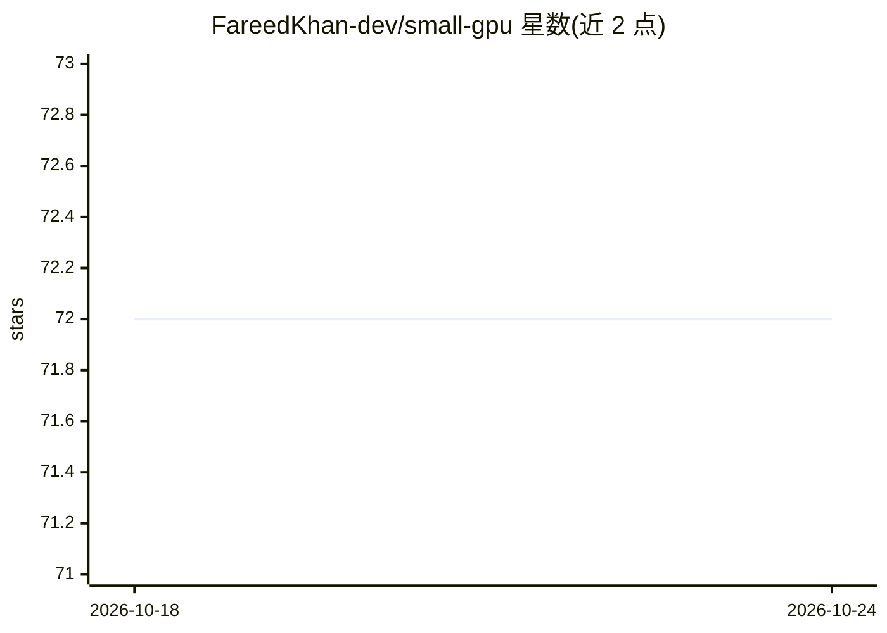

# FareedKhan-dev/small-gpu

⭐ 72 · SystemVerilog · MIT · 推送 2026-01-22 · [GitHub](https://github.com/FareedKhan-dev/small-gpu) · [官网](https://medium.com/@fareedkhandev/building-a-tiny-gpu-to-learn-understand-ai-hardware-engineering-for-ai-computation-fundamental-62bb08f2d1d1) · 个人维护

**面向 AI 工程师的 GPU 硬件教程：用 SystemVerilog 从零构建迷你 GPU**

以博客/教程形式讲解 GPU 硬件的工作原理：先介绍 GPU 的计算核心、内存控制器、寄存器堆、调度器等组件构成，再以 NVIDIA H100 为对照，用 SystemVerilog 硬件描述语言在操作系统上以仿真方式搭建一个简化的 Tiny GPU（含 12 个核心组件），并用 ALU 等模块开始实现基础运算。讲解中大量使用 PyTorch/Torch 概念做类比（module 对应 nn.Module、位宽对应 dtype、时钟更新对应 optimizer.step()）。读者通过阅读和跟随编写代码来理解硬件如何执行 AI 工作负载，不产出可部署的模型输出。

## 筛选速览

| 维度 | 判定 | 备注 |
|---|---|---|
| AI 角色 | `ai-knowledge` | 知识聚合/清单类 |
| 许可风险 | `permissive` | MIT |
| 部署形态 | `None` |  |
| 模型依赖 | — | README 未给出锁定关系 |
| 硬件要求 | — | 无带数字的原话,不猜 |
| 安装摩擦 | `medium` | 含编译或系统依赖之一 |
| 成熟度 | — | 结构信号不足 |

## 能力要点

- 用 SystemVerilog 仿真搭建简化的 Tiny GPU，无需流片与专用硬件实验室
- 以 NVIDIA H100 为对照点讲解 GPU 架构（去掉了分支预测与缓存等复杂机制）
- 将硬件概念映射为 AI 工程师熟悉的 PyTorch 概念（nn.Module、dtype、optimizer.step()）
- 从 ALU 等基础模块开始逐步实现核心组件

## 适用场景

- AI/软件工程师理解 GPU 硬件执行模型的入门学习
- 跟随教程学习 SystemVerilog 硬件描述语言基础
- 想了解矩阵乘法等 AI 计算在硅片层面如何发生的开发者

## 场景标签

`教程课程` · 领域:学习与行业

## 证据(README 行号)

> L17: > We will design a tiny GPU and explore its 12 core components, understanding how each one works from an AI enginee
> L25: Normally, building a GPU requires access to fabrication plants, and specialized hardware labs. But to make things a
> L29: To make things a bit easier, I will use the NVIDIA H100 as a comparison point, since it is currently the gold stand

## 星数曲线

2026-10-18 72 → 2026-10-24 72（+0）

---
*卡片 v1 · prompt 1.4 · 生成 2026-10-24 · 置信度 high · 依据 README sha `8a41c0e39118` · [字段定义](../../DATASET.md)*
