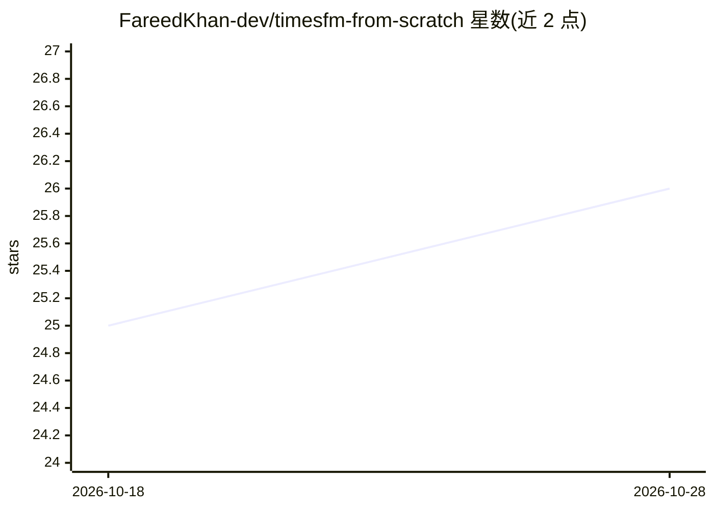

# FareedKhan-dev/timesfm-from-scratch

⭐ 26 · Python · NOASSERTION · 推送 2026-06-27 · [GitHub](https://github.com/FareedKhan-dev/timesfm-from-scratch) · [官网](https://medium.com/@fareedkhandev/building-a-200m-parameter-time-series-forecasting-llm-from-scratch-a99ec624ba15) · 个人维护

**从零复现 Google TimesFM 并补齐未开源的预训练流水线**

独立研究性复现项目：用 PyTorch 从零重写 TimesFM 2.5 解码器架构（RoPE、sandwich RMSNorm、fused QKV 等），并重建 Google 未开源的预训练栈——合成数据生成器、全位置 masked 目标、RevIN、多样化数据混合与分布外验证。提供 tiny/small/base 三种规模配置，在 70M 规模完成训练与评测，权重托管于 Hugging Face。声明局限：随机游走数据上劣于朴素基线、校准依赖事后 conformal 包装、无 KV-cache。

## 筛选速览

| 维度 | 判定 | 备注 |
|---|---|---|
| AI 角色 | `ai-native` | 本体是模型或模型工具 |
| 许可风险 | `none` | NOASSERTION |
| 部署形态 | `library` | 以包/库形式分发 |
| 模型依赖 | — | README 未给出锁定关系 |
| 硬件要求 | — | 无带数字的原话,不猜 |
| 安装摩擦 | `medium` | 含编译或系统依赖之一 |
| 成熟度 | — | 结构信号不足 |

## 能力要点

- 203M backbone 参数量与官方 checkpoint 精确对齐的忠实复现
- 重建未开源预训练流水线（合成数据、all-positions 目标、多样化混合、OOD 验证）
- 70M 预训练权重与 safetensors 版本托管于 Hugging Face
- 29 个单元测试、overfit-a-batch 门控与完整训练 CLI

## 适用场景

- 学习时序基础模型的架构与预训练完整流程
- 在能源等结构化时序上做零样本点预测与分位区间预测
- 复现诚实评测协议（bootstrap CI、CRPS、coverage）的研究参考

## 场景标签

`模型训练` · 领域:训练与推理

## 证据(README 行号)

> L3: A from-scratch reimplementation of Google's **TimesFM** time-series foundation model, including the
> L28: TimesFM is a **decoder-only transformer over time-series patches**. You give it the recent history of any
> L29: single numeric series (for example the last 512 hourly readings), and it predicts the next 96 to 192

## 星数曲线

2026-10-18 25 → 2026-10-28 26（+1）

---
*卡片 v1 · prompt 1.4 · 生成 2026-10-27 · 置信度 high · 依据 README sha `934a2309309b` · [字段定义](../../DATASET.md)*
