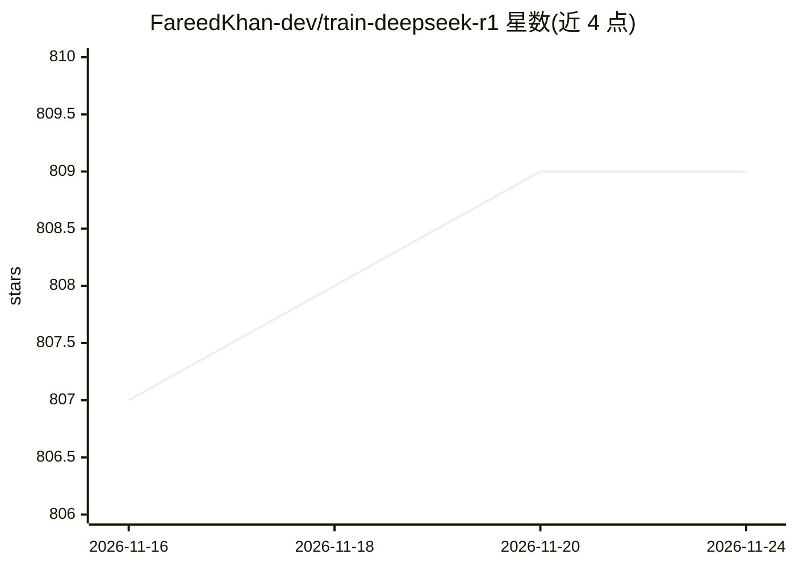

# FareedKhan-dev/train-deepseek-r1

⭐ 809 · Jupyter Notebook · MIT · 推送 2026-11-16 · [GitHub](https://github.com/FareedKhan-dev/train-deepseek-r1) · [官网](https://medium.com/@fareedkhandev/building-deepseek-r1-from-scratch-using-python-a967fbfdaac4) · 个人维护

**从零复现 DeepSeek R1 训练流程的教程与代码仓库**

跟随 DeepSeek R1 技术报告逐步复现其训练流程的教学仓库：以 Qwen2.5-0.5B-Instruct（可选 7B）为小体积基座模型，使用 GRPO 强化学习算法和多阶段奖励函数（准确性、格式、推理步骤、余弦缩放、重复惩罚）训练推理模型，配合手绘流程图讲解理论。代码以 Jupyter notebook 形式提供，附奖励函数测试与非技术读者科普文档。需 Python 3.11+、Linux + 单张 NVIDIA GPU 环境测试，vLLM 为可选加速项。

## 筛选速览

| 维度 | 判定 | 备注 |
|---|---|---|
| AI 角色 | `ai-knowledge` | 知识聚合/清单类 |
| 许可风险 | `permissive` | MIT |
| 部署形态 | `library` | 以包/库形式分发 |
| 模型依赖 | local-ok | 支持本地模型 |
| 硬件要求 | `gpu-8g` | |
| 安装摩擦 | `medium` | 含编译或系统依赖之一 |
| 成熟度 | — | 结构信号不足 |

## 能力要点

- 以 Qwen2.5-0.5B 为基座、GRPO 算法复现 R1 Zero/R1 训练流程
- 五类奖励函数：准确性、格式、推理步骤、余弦缩放、重复惩罚
- 使用 NuminaMath-TIR 与 Bespoke-Stratos-17k 推理数据集
- 附手绘流程图、奖励函数测试与非技术读者科普文档

## 适用场景

- 学习 DeepSeek R1 的 GRPO 强化学习训练原理与实现
- 在本地单卡 GPU 上跑通小模型推理训练实验
- 了解 R1 Zero 与多阶段 R1 训练管线的差异

## 场景标签

`教程课程` `强化学习` · 领域:学习与行业

## 证据(README 行号)

> L7: To make everything easy to understand we will use hand drawn flowcharts along with the code and will follow the step
> L9: We will also be covering theory next to each step, so in case you are not aware of DeepSeek R1 this blog will cover 

## 星数曲线

2026-11-16 807 → 2026-11-24 809（+2）

---
*卡片 v1 · prompt 1.4 · 生成 2026-11-17 · 置信度 high · 依据 README sha `b61be4a9a5c0` · [字段定义](../../DATASET.md)*
