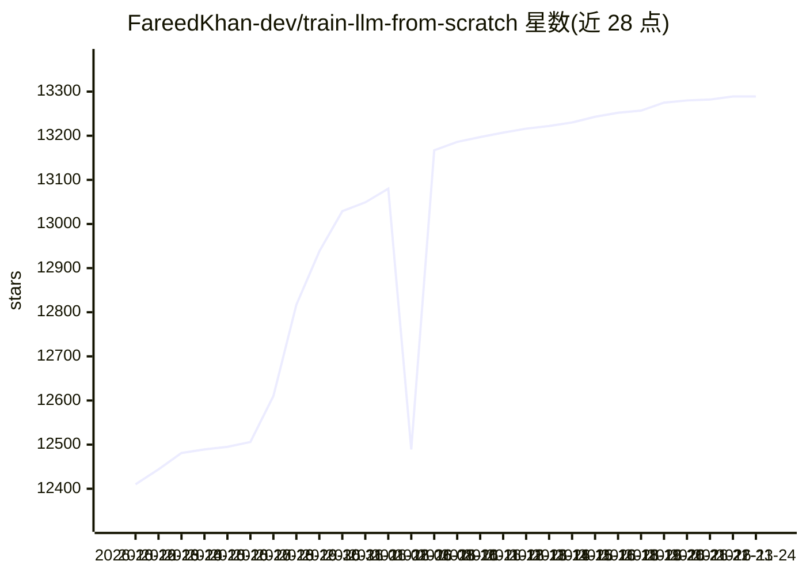

# FareedKhan-dev/train-llm-from-scratch

⭐ 13,292 · Python · MIT · 推送 2026-11-16 · [GitHub](https://github.com/FareedKhan-dev/train-llm-from-scratch) · [官网](https://fareedkhan-dev.github.io/train-llm-from-scratch/) · 个人维护

**从原始文本到推理模型的 LLM 训练教程代码库**

基于 PyTorch 从零手写实现的 Transformer 训练项目，源自 Attention is All You Need 论文，覆盖预训练、SFT、奖励模型、PPO/DPO、GRPO 到评估与对话的完整流程。另提供采用 RoPE、RMSNorm、SwiGLU、MoE、KV cache 的现代架构版本，Muon 优化器、LoRA、投机解码等技巧均为手工实现，不依赖 trl/peft/transformers。面向学生、开发者与研究者，可在笔记本 CPU 上训练小模型，也可用单 GPU 训练十亿参数级模型。

## 筛选速览

| 维度 | 判定 | 备注 |
|---|---|---|
| AI 角色 | `ai-knowledge` | 知识聚合/清单类 |
| 许可风险 | `permissive` | MIT |
| 部署形态 | `self-host` | docker 或自建部署 |
| 模型依赖 | — | README 未给出锁定关系 |
| 硬件要求 | — | 无带数字的原话,不猜 |
| 安装摩擦 | `low` | 无编译、无系统依赖或容器化 |
| 成熟度 | — | 结构信号不足 |

## 能力要点

- 全流程手写实现：预训练→SFT→奖励模型→PPO/DPO→GRPO
- 无需 GPU：笔记本 CPU 约 10 分钟训练 369K 参数模型
- 现代架构路径（RoPE/RMSNorm/MoE/KV cache）与 legacy 路径均可训练
- 提供 GPU 型号与可训模型规模的对照表及显存优化开关

## 适用场景

- 在笔记本 CPU 上从零跑通小型 LLM 训练全流程
- 学习 SFT、DPO、GRPO 等后训练算法的手写实现
- 用单 GPU 训练十亿参数级的自有模型
- 按 GPU 显存选型确定可训练的模型规模

## 场景标签

`教程课程` `模型训练` `微调` `强化学习` · 领域:学习与行业

## 证据(README 行号)

> L9: I implemented a transformer model from scratch using PyTorch, based on the paper Attention is All You Need. You can 
> L11: This started as a pretraining tutorial. It now goes all the way from raw text to an aligned, reasoning style model,
> L41: - If you are a **student**, read top to bottom. Every block of code comes after a plain explanation of what it does
> L42: - If you are a **developer**, the commands and file paths are all here. You can copy, run, and read the referenced 
> L43: - If you are a **researcher**, the post-training half is the interesting part: SFT, a Bradley-Terry reward model, P

## 星数曲线

2026-10-22 12,410 → 2026-11-24 13,289（+879）

---
*卡片 v1 · prompt 1.4 · 生成 2026-11-22 · 置信度 mid · 依据 README sha `8068fed0bcdc` · [字段定义](../../DATASET.md)*
