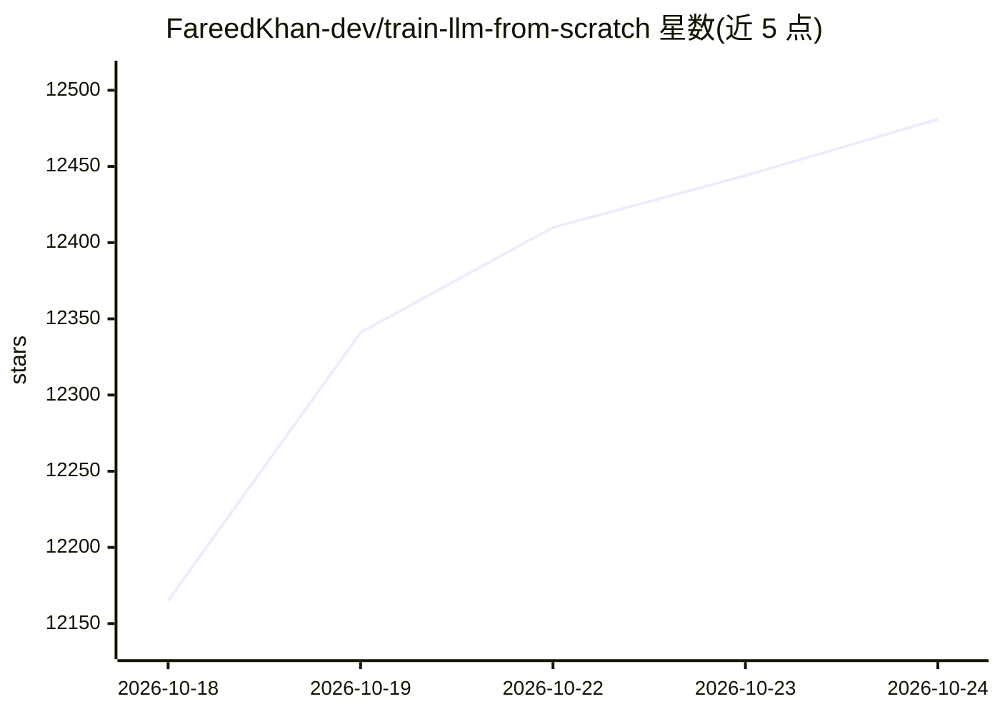

# FareedKhan-dev/train-llm-from-scratch

⭐ 12,481 · Python · MIT · 推送 2026-10-02 · [GitHub](https://github.com/FareedKhan-dev/train-llm-from-scratch) · [官网](https://fareedkhan-dev.github.io/train-llm-from-scratch/) · 个人维护

**从零手写 PyTorch 训练 LLM 的教学仓库：数据到推理全流程**

基于 Attention is All You Need 用纯 PyTorch（不依赖 transformers/trl/peft）从零实现 Transformer 并完成全流程训练的教程型仓库：涵盖 BPE 分词、预训练、SFT、奖励模型、PPO/DPO/GRPO 等后训练算法，另含现代架构（RoPE、RMSNorm、MoE、KV cache）与 Muon/LoRA/SimPO 等技巧的手写实现。支持单 GPU 训练十亿级参数模型，或在笔记本 CPU 上数分钟训练 369K 参数小模型。面向学生、开发者和研究者，通过 git clone + pip editable 安装，各阶段由 JSON 配置驱动。

## 筛选速览

| 维度 | 判定 | 备注 |
|---|---|---|
| AI 角色 | `ai-knowledge` | 知识聚合/清单类 |
| 许可风险 | `permissive` | MIT |
| 部署形态 | `library` | 以包/库形式分发 |
| 模型依赖 | — | README 未给出锁定关系 |
| 硬件要求 | — | 无带数字的原话,不猜 |
| 安装摩擦 | `medium` | 含编译或系统依赖之一 |
| 成熟度 | — | 结构信号不足 |

## 能力要点

- 纯 PyTorch 手写 Transformer 与 SFT/奖励模型/PPO/DPO/GRPO 全流程
- 无 GPU 也可在笔记本 CPU 约 5 分钟训练 369K 参数小模型
- 提供现代架构实现（RoPE、RMSNorm、SwiGLU、MoE、KV cache）
- 四条数据流：预训练（The Pile）、SFT、偏好对、RL 提示词

## 适用场景

- 想理解 LLM 从原始文本到对齐模型的完整训练过程
- 在没有 GPU 的笔记本上亲手训练一个小型语言模型
- 研究者在同一小模型上复现并修改后训练算法

## 场景标签

`教程课程` · 领域:学习与行业

## 证据(README 行号)

> L9: I implemented a transformer model from scratch using PyTorch, based on the paper Attention is All You Need. You can 
> L11: This started as a pretraining tutorial. It now goes all the way from raw text to an aligned, reasoning style model,
> L41: - If you are a **student**, read top to bottom. Every block of code comes after a plain explanation of what it does

## 星数曲线

2026-10-18 12,165 → 2026-10-24 12,481（+316）

---
*卡片 v1 · prompt 1.4 · 生成 2026-10-20 · 置信度 high · 依据 README sha `fc2b91b439a9` · [字段定义](../../DATASET.md)*
