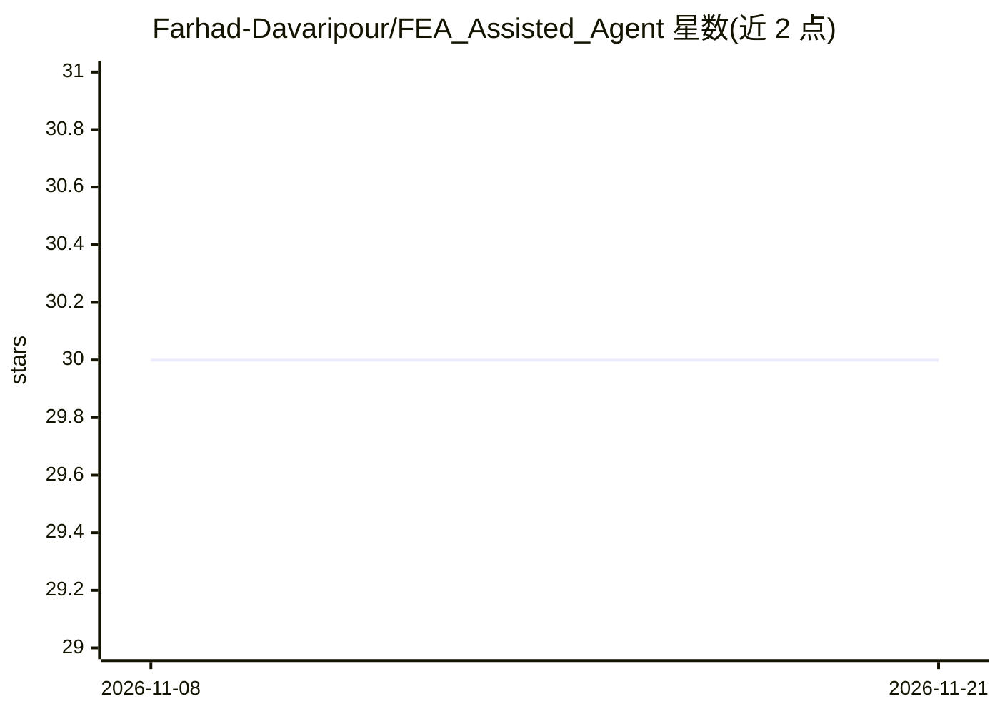

# Farhad-Davaripour/FEA_Assisted_Agent

⭐ 30 · Python · MIT · 推送 2026-11-02 · [GitHub](https://github.com/Farhad-Davaripour/FEA_Assisted_Agent) · [官网](https://farhad-davaripour.dev/) · 个人维护

**用 LLM agent 自动化 Abaqus 有限元仿真与参数化分析**

面向 Abaqus 用户的自动化工具：基于 LlamaIndex 与 OpenAI 模型构建 ReAct agent，通过 Streamlit 界面执行仿真工作流，包括参数化 .inp 输入文件生成、作业执行、Von-Mises 应力提取（解析 ODB 文件并记录峰值）、位移参数化研究以及按 STRESS_THRESHOLD 阈值的实时应力评估；Phoenix 提供工具调用追踪与幻觉检测等评测能力。运行需本机安装 Abaqus，通过 pip 安装依赖后以 streamlit 启动。

## 筛选速览

| 维度 | 判定 | 备注 |
|---|---|---|
| AI 角色 | `ai-native` | 本体是模型或模型工具 |
| 许可风险 | `permissive` | MIT |
| 部署形态 | `library` | 以包/库形式分发 |
| 模型依赖 | — | README 未给出锁定关系 |
| 硬件要求 | — | 无带数字的原话,不猜 |
| 安装摩擦 | `low` | 无编译、无系统依赖或容器化 |
| 成熟度 | — | 结构信号不足 |

## 能力要点

- 生成参数化 Abaqus .inp 输入文件并执行作业
- 解析 ODB 提取 Von-Mises 峰值应力并按阈值实时评估
- ReAct agent 自动化多组位移参数化研究
- Phoenix 追踪与评测（工具选择正确性、幻觉检测）

## 适用场景

- 自动生成并运行 Abaqus 有限元仿真作业
- 批量执行参数化位移试验并汇总应力结果
- 在仿真过程中监控应力是否超出设定阈值

## 场景标签

`工作流自动化` `代码生成` · 领域:效率与自动化

## 证据(README 行号)

> L4: The **FEA Assisted Agent** automates Abaqus finite element simulations. It leverages OpenAI models through **LlamaIn
> L11: 4. **Parametric Studies** – Uses a ReAct-based agent to automate multiple displacement trials.

## 星数曲线

2026-11-08 30 → 2026-11-21 30（+0）

---
*卡片 v1 · prompt 1.4 · 生成 2026-11-18 · 置信度 high · 依据 README sha `54ecccec855c` · [字段定义](../../DATASET.md)*
