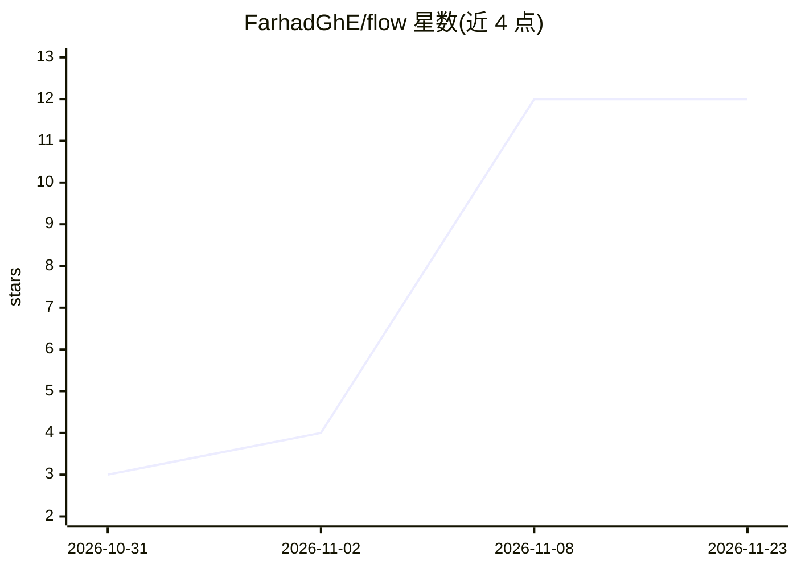

# FarhadGhE/flow

⭐ 12 · CC0-1.0 · 推送 2026-11-14 · [GitHub](https://github.com/FarhadGhE/flow) · 个人维护

**AI 辅助项目的纯 Markdown 管理仓库模板，供 agent 运行**

一个 Git 同步的项目管理仓库模板：以 experts（单一领域）与 coordinations（跨领域协作）组织工作，所有请求逐字记录、结果落为文件、每轮提交，使新会话可从中断处继续。仓库内无脚本，agent 通过阅读 __Manager/ 下的 AGENTS.md 与规则模板执行任务。支持由 agent 完成四步初始化，提供带前缀的 /plan 与 /coordinate 命令约定，以 CC0 1.0 公有领域发布。

## 筛选速览

| 维度 | 判定 | 备注 |
|---|---|---|
| AI 角色 | `ai-ecosystem` | LLM/agent 周边工具 |
| 许可风险 | `viral` | CC0-1.0 |
| 部署形态 | `None` |  |
| 模型依赖 | — | README 未给出锁定关系 |
| 硬件要求 | — | 无带数字的原话,不猜 |
| 安装摩擦 | `low` | 无编译、无系统依赖或容器化 |
| 成熟度 | — | 结构信号不足 |

## 能力要点

- 纯 Markdown 结构，无脚本，agent 依 AGENTS.md 规则工作
- experts/coordinations 两层组织与逐字请求记录、每轮 Git 提交
- 支持跨机器/跨成员的 Set me up 与 Upgrade the flow 流程
- 以 CC0 1.0 公有领域许可提供

## 适用场景

- 为使用 Claude Code 或 Codex 等 agent 的项目建立可同步的项目记忆
- 多会话之间接续 AI 辅助开发工作进度
- 团队多人通过同一管理仓库协作 agent 任务

## 场景标签

`编码 Agent` · 领域:编码与开发

## 证据(README 行号)

> L3: A template for a **manage repo**: the Git-synced memory of an AI-assisted project. Your agent (Claude
> L7: pick up where the last one stopped. There are no scripts: the agent follows the markdown in `__Manager/`.

## 星数曲线

2026-10-31 3 → 2026-11-23 12（+9）

---
*卡片 v1 · prompt 1.4 · 生成 2026-11-18 · 置信度 high · 依据 README sha `afd497042304` · [字段定义](../../DATASET.md)*
