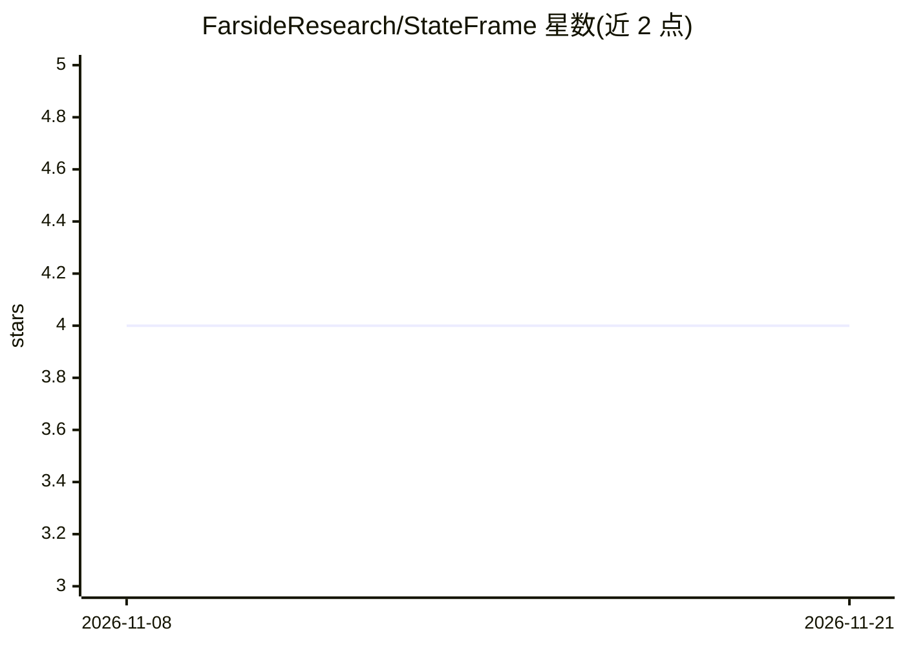

# FarsideResearch/StateFrame

⭐ 4 · Python · AGPL-3.0 · 推送 2026-11-20 · [GitHub](https://github.com/FarsideResearch/StateFrame) · [官网](https://farsideresearch.com) · 组织维护

**长时运行 agent 的开源引擎：固定提示预算、无历史压缩**

StateFrame 是面向长时运行 agent 的引擎，每轮请求不发送聊天历史，而是从系统指令、工具、任务、类型化状态帧与最新一轮交互重新构建，使提示长度不随任务增长（默认预算 33,344 token）。引擎持有工具菜单、守卫、完成检查与测试门，状态保存在本地磁盘；支持断点续跑、请求字节级可复现、并行子帧与沙箱化 mutations（agent 可自写工具）。安装走 install.sh，需连接 OpenAI 兼容服务端；mutation 执行目前要求 Linux。以 AGPL-3.0 或商业许可提供，当前为 preview 版本。

## 筛选速览

| 维度 | 判定 | 备注 |
|---|---|---|
| AI 角色 | `ai-ecosystem` | LLM/agent 周边工具 |
| 许可风险 | `dual` | AGPL-3.0 |
| 部署形态 | `library` | 以包/库形式分发 |
| 模型依赖 | — | README 未给出锁定关系 |
| 硬件要求 | — | 无带数字的原话,不猜 |
| 安装摩擦 | `low` | 无编译、无系统依赖或容器化 |
| 成熟度 | `idea` | |

## 能力要点

- 固定提示预算（33,344 token）且无历史压缩，长任务不增长上下文
- 断点续跑：stateframe resume 支持 Ctrl-C、kill -9、崩溃或服务器丢失后恢复
- 并行子帧替代子 agent：从冻结快照分叉，父级验证并合并提案
- Mutations：agent 可在沙箱中编写并验证自己的 Python 辅助工具

## 适用场景

- 在单张 GPU 上同时运行多个长时软件工程任务 agent
- 需要中断后无损恢复的自动化代码修复任务
- 让 agent 产出报告、数据文件等非代码交付物并通过自动测试校验

## 场景标签

`Agent 框架` `Agent 记忆` `编码 Agent` · 领域:Agent 开发

## 证据(README 行号)

> L7: StateFrame is an Open Agent Engine for long-running agents, built and measured on software engineering work. It neve
> L18: - **Behavior is enforced by the engine, not left to the model.** The engine owns the tool menu, the guards, the com
> L27: - **Local first.** It talks to any OpenAI-compatible server on your machine, such as llama.cpp, uses the server's p

## 星数曲线

2026-11-08 4 → 2026-11-21 4（+0）

---
*卡片 v1 · prompt 1.4 · 生成 2026-11-21 · 置信度 high · 依据 README sha `3ef063f4e641` · [字段定义](../../DATASET.md)*
