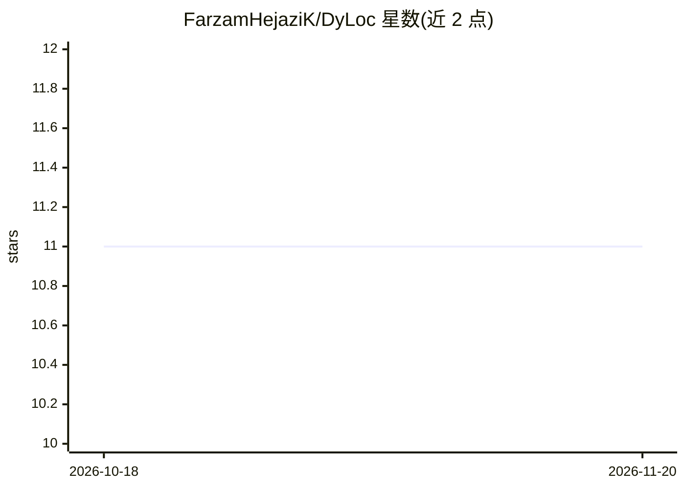

# FarzamHejaziK/DyLoc

⭐ 11 · Python · 推送 2026-06-07 · [GitHub](https://github.com/FarzamHejaziK/DyLoc) · [官网](https://doi.org/10.1109/INFOCOM42981.2021.9488913) · 个人维护

**大规模 MIMO 动态定位论文复现代码（PredRNN）**

IEEE INFOCOM 2021 论文 DyLoc 的配套代码仓库：用 MATLAB 生成基于 DeepMIMO 的散射环境与 CSI-位置数据集，经 CSV 转 NPZ 后依次训练 DCNN、DCNN+WKNN 与 PredRNN，最终在论文中的三个场景下测试动态定位性能并输出 RSE 结果。提供预生成数据集与预训练权重的下载途径，可跳过 MATLAB 与训练步骤直接运行测试；作者留有邮箱联系方式。

## 筛选速览

| 维度 | 判定 | 备注 |
|---|---|---|
| AI 角色 | `ai-native` | 本体是模型或模型工具 |
| 许可风险 | `none` | — |
| 部署形态 | `None` |  |
| 模型依赖 | — | README 未给出锁定关系 |
| 硬件要求 | — | 无带数字的原话,不猜 |
| 安装摩擦 | `low` | 无编译、无系统依赖或容器化 |
| 成熟度 | — | 结构信号不足 |

## 能力要点

- MATLAB 生成 CSI-位置数据集（Dataset_gen.m 等）并输出 CSV
- Pipeline 覆盖 DCNN、DCNN+WKNN 与 PredRNN 的训练与测试
- 提供 Google Drive 预生成 npz 数据集与权重，可跳过 MATLAB 与训练
- 输出各实验的 RSE 结果文件

## 适用场景

- 复现 DyLoc 论文的动态定位实验结果
- 基于 DeepMIMO 自定义环境重新生成数据并训练模型
- 直接用预训练权重测试三个场景的定位误差

## 场景标签

 · 领域:无线通信/定位研究

## 证据(README 行号)

> L5: This repository contains code for the DyLoc paper:
> L7: Farzam Hejazi, Katarina Vuckovic, and Nazanin Rahnavard. "DyLoc: Dynamic Localization for Massive MIMO Using Predict
> L35: Finally, everything is available to test DyLoc. Copy PredRNN weights to "PredRNN Models" folder. Copy DCNN weights 

## 星数曲线

2026-10-18 11 → 2026-11-20 11（+0）

---
*卡片 v1 · prompt 1.4 · 生成 2026-11-19 · 置信度 high · 依据 README sha `08231c9aebc8` · [字段定义](../../DATASET.md)*
