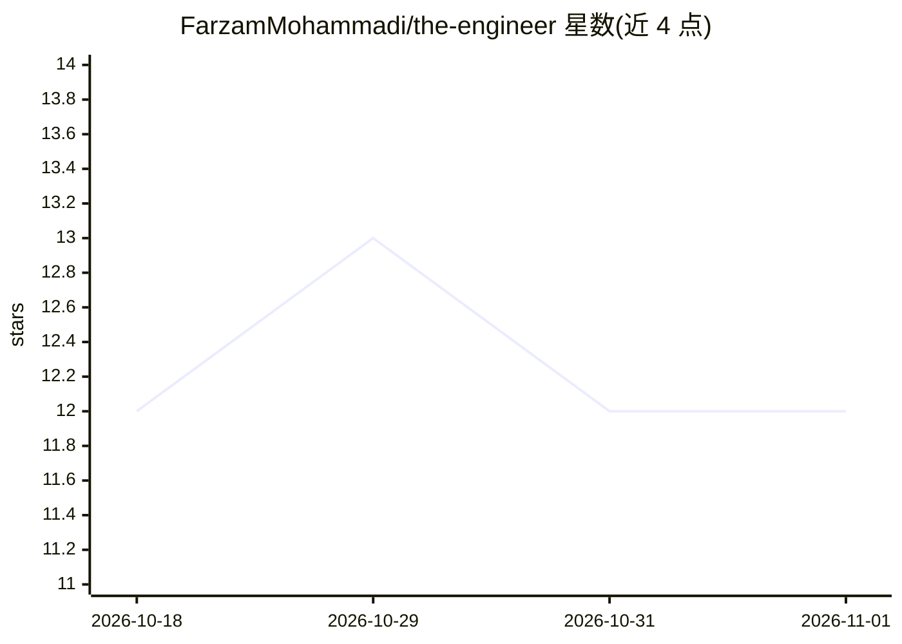

# FarzamMohammadi/the-engineer

⭐ 12 · TypeScript · MIT · 推送 2026-07-12 · [GitHub](https://github.com/FarzamMohammadi/the-engineer) · [官网](https://farzammohammadi.github.io/the-engineer/) · 个人维护

**把 AI 编码 CLI 编排成自主工程师的任务编排守护进程**

长驻 Node.js 守护进程，监听 GitHub Issues 等触发源接收任务，驱动 Claude Code、OpenCode、Gemini CLI 等编码 CLI 走完需求→研究→规划→执行→审查→交付六阶段流水线，直至提交并按审批合并 PR。任务各自隔离在独立 git worktree 中运行；人保留在需求、关键决策与最终审批环节。提供四类可替换插件适配器（触发/通讯/Agent/Git 托管）、按任务/日/月的成本上限、基于 SQLite 的审计事件总线与本地 React 仪表盘（localhost:3847）。单人维护，自述早期版本。通过 git clone + pnpm 从源码安装，需 Node.js 22+ 与 pnpm。

## 筛选速览

| 维度 | 判定 | 备注 |
|---|---|---|
| AI 角色 | `ai-ecosystem` | LLM/agent 周边工具 |
| 许可风险 | `permissive` | MIT |
| 部署形态 | `library` | 以包/库形式分发 |
| 模型依赖 | — | README 未给出锁定关系 |
| 硬件要求 | — | 无带数字的原话,不猜 |
| 安装摩擦 | `low` | 无编译、无系统依赖或容器化 |
| 成熟度 | `idea` | |

## 能力要点

- 六阶段工程流水线：需求→研究→规划→执行→审查→交付，跨阶段保留上下文
- 每任务独立 git worktree 隔离，支持抢占式调度与有界重试
- 成本上限：按任务/日/月累计，达到 80% 警告、100% 终止在途任务
- 四类可替换插件适配器，含 claude-code/opencode/gemini-cli agent 插件

## 适用场景

- 让 AI 编码 CLI 自主处理 GitHub Issue 并交付可合并的 PR
- 在关键决策与最终审批处保留人工介入的自动化开发流程
- 观察与审计 AI agent 的每个动作与花费

## 场景标签

`编码 Agent` · 领域:编码与开发

## 证据(README 行号)

> L8: An autonomous orchestrator for AI coding agents. The Engineer drives Claude Code, OpenCode, and other CLI agents thr
> L26: The Engineer is the orchestration layer that closes that gap. It runs as a long-lived daemon that listens for tasks
> L130: |`AgentAdapter`|`claude-code-agent`, `opencode-agent`, `gemini-cli-agent`|Codex, Aider, any CLI agent that edits f

## 星数曲线

2026-10-18 12 → 2026-11-01 12（+0）

---
*卡片 v1 · prompt 1.4 · 生成 2026-11-01 · 置信度 mid · 依据 README sha `dd60d1a36ed6` · [字段定义](../../DATASET.md)*
