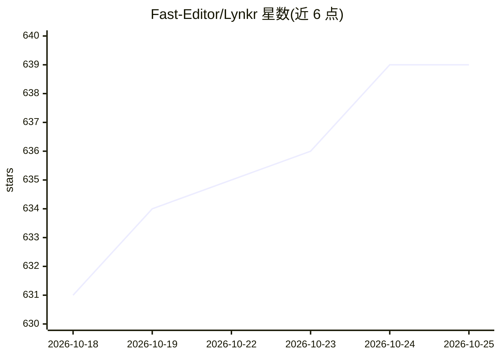

# Fast-Editor/Lynkr

⭐ 639 · JavaScript · Apache-2.0 · 推送 2026-10-21 · [GitHub](https://github.com/Fast-Editor/Lynkr) · [官网](http://lynkrhq.com/) · 组织维护

**面向 AI 编程工具的 LLM 网关：token 压缩、语义缓存与分级路由**

Node.js 实现的本地 HTTP 代理与 LLM 网关，供 Claude Code、Cursor、Codex、Cline、Continue 等编程工具接入：按请求难度把任务路由到 SIMPLE/MEDIUM/COMPLEX/REASONING 各级模型，支持 4 个本地（Ollama、llama.cpp、LM Studio 等）和 14+ 云端提供商。机制包括 JSON 工具结果压缩、语义缓存（缓存命中 0 token 计费）、粘性会话与自动升级、夜间用自身流量再校准路由阈值，以及本地遥测仪表盘。通过 npm 安装，交互式向导生成 .env，无需改动工具代码。部分提供商（百度千帆、Fireworks）标注为未经实测验证。

## 筛选速览

| 维度 | 判定 | 备注 |
|---|---|---|
| AI 角色 | `ai-ecosystem` | LLM/agent 周边工具 |
| 许可风险 | `permissive` | Apache-2.0 |
| 部署形态 | `self-host` | docker 或自建部署 |
| 模型依赖 | local-ok | 支持本地模型 |
| 硬件要求 | — | 无带数字的原话,不猜 |
| 安装摩擦 | `low` | 无编译、无系统依赖或容器化 |
| 成熟度 | — | 结构信号不足 |

## 能力要点

- 分层路由：简单请求走本地/低价模型，复杂请求自动升级
- JSON 工具结果压缩与语义缓存（重复查询 <300ms 命中、0 token 计费）
- 支持 4 个本地 + 14+ 云端提供商，含 OpenAI 兼容 SSE 流式透传与格式转换
- 内置仪表盘读取本地遥测，展示花费与节省对比

## 适用场景

- 让 Claude Code / Cursor 等编程助手复用本地 Ollama 与订阅/API 的混合算力
- 压缩工具调用密集会话的 token 消耗以降低成本
- 公司内通过 Databricks / Azure / Bedrock 统一出口代理编程工具流量

## 场景标签

`模型网关` · 领域:Agent 开发

## 证据(README 行号)

> L3: ### An LLM Gateway which optimises your token usage.
> L165: Claude Code / Cursor / Codex / Cline / Continue
> L167:                   Lynkr

## 星数曲线

2026-10-18 631 → 2026-10-25 639（+8）

---
*卡片 v1 · prompt 1.4 · 生成 2026-10-21 · 置信度 mid · 依据 README sha `914ff341489e` · [字段定义](../../DATASET.md)*
