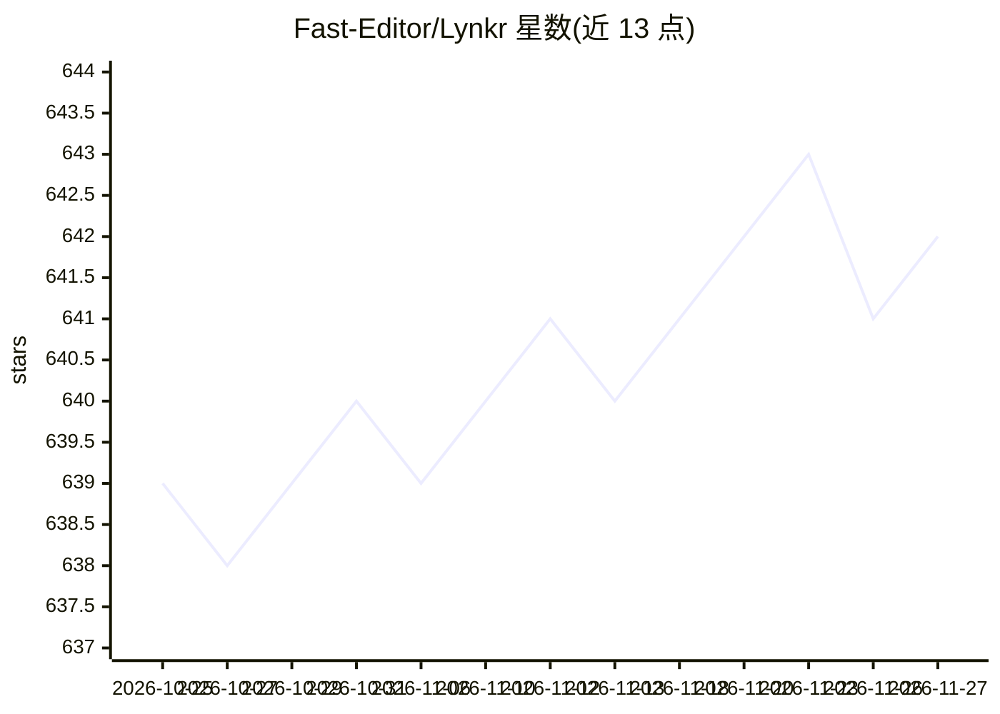

# Fast-Editor/Lynkr

⭐ 642 · JavaScript · Apache-2.0 · 推送 2026-11-15 · [GitHub](https://github.com/Fast-Editor/Lynkr) · [官网](http://lynkrhq.com/) · 个人维护

**面向 AI 编程工具的 LLM 网关：分层路由压缩 token**

一个 Node.js 实现的 LLM 网关与 HTTP 代理，置于 Claude Code、Cursor、Codex、Cline 等编程工具与上游模型之间。核心机制包括按请求难度在 SIMPLE/MEDIUM/COMPLEX/REASONING 四档模型间自动分层路由（基于嵌入分类与可选路由评审）、TOON/RTK 工具结果压缩、语义缓存、会话粘滞与自动升级。通过 npm 全局安装，以交互式向导或 .env 配置，支持 4 个本地与 14+ 云端提供商，提供 SSE 流式转换与基准测试脚本。

## 筛选速览

| 维度 | 判定 | 备注 |
|---|---|---|
| AI 角色 | `ai-ecosystem` | LLM/agent 周边工具 |
| 许可风险 | `permissive` | Apache-2.0 |
| 部署形态 | `self-host` | docker 或自建部署 |
| 模型依赖 | local-ok | 支持本地模型 |
| 硬件要求 | — | 无带数字的原话,不猜 |
| 安装摩擦 | `low` | 无编译、无系统依赖或容器化 |
| 成熟度 | — | 结构信号不足 |

## 能力要点

- 分层路由：按请求难度自动分派至免费/付费模型，会话粘滞与自动升级
- TOON/RTK 压缩大 JSON 工具结果，语义缓存 <300ms 命中且不计费
- 支持 4 个本地提供商（Ollama/llama.cpp/LM Studio 等）与 14+ 云端提供商
- 内置基准脚本兼作路由回归测试，可复现对比数据

## 适用场景

- 让简单请求走本地免费模型，订阅额度留给复杂任务
- 给 Cursor/Claude Code 换一个统一的模型接入端点
- 压缩工具输出以减少 agent 会话的 token 消耗
- 企业通过 Databricks/Azure/Bedrock 自有基础设施路由请求

## 场景标签

`模型网关` · 领域:Agent 开发

## 证据(README 行号)

> L3: ### An LLM Gateway which optimises your token usage.
> L162: AI coding tools lock you into one provider and send every token raw. Lynkr breaks both locks.
> L177: - ✅ Route through **your company's infrastructure** (Databricks, Azure, Bedrock)

## 星数曲线

2026-10-25 639 → 2026-11-27 642（+3）

---
*卡片 v1 · prompt 1.4 · 生成 2026-11-24 · 置信度 mid · 依据 README sha `c5f2db3234fe` · [字段定义](../../DATASET.md)*
