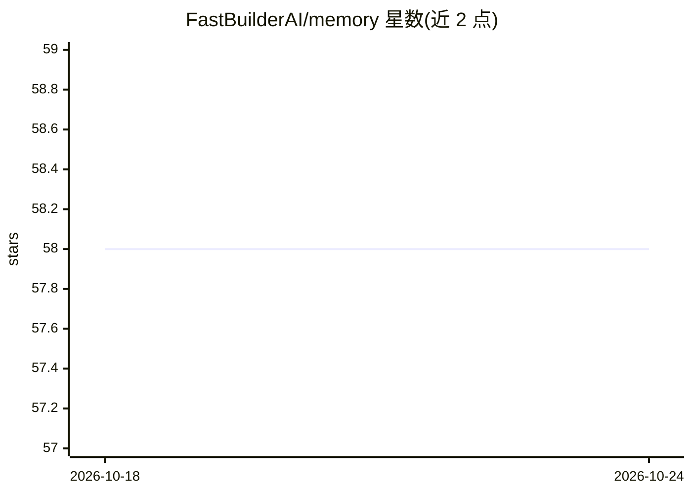

# FastBuilderAI/memory

⭐ 58 · Rust · MIT · 推送 2026-10-04 · [GitHub](https://github.com/FastBuilderAI/memory) · [官网](https://fastbuilder.ai/fastmemory) · 组织维护

**为 AI agent 提供无嵌入的拓扑记忆图引擎，替代向量检索**

由 FastBuilder.AI 开发的本体聚类引擎：将非结构化文本解析为按 Topology 分类法（Component/Block/Function/Data/Access/Event）组织的功能记忆图，使用 Louvain 社区检测聚类，不依赖嵌入。提供 Rust CLI（cargo 安装，支持 build/query/serve/mcp 命令）、Python 模块（PyO3 编译）、内嵌 Axum REST 服务器与 MCP 集成。可从本地目录或 Snowflake/BigQuery/S3 等远程数据源摄取，聚类 JSON 可映射到 Neo4J。检索为词法匹配（词干与容错拼写），README 撤回了早前的性能声明并给出可复现的 SQuAD 对比，注明在干净问题和短关键词查询上低于 BM25。

## 筛选速览

| 维度 | 判定 | 备注 |
|---|---|---|
| AI 角色 | `ai-ecosystem` | LLM/agent 周边工具 |
| 许可风险 | `permissive` | MIT |
| 部署形态 | `library` | 以包/库形式分发 |
| 模型依赖 | — | README 未给出锁定关系 |
| 硬件要求 | — | 无带数字的原话,不猜 |
| 安装摩擦 | `low` | 无编译、无系统依赖或容器化 |
| 成熟度 | — | 结构信号不足 |

## 能力要点

- Topology 六类分类法组织文本，无嵌入构建功能记忆图
- Rust CLI + Python 模块 + REST 服务器 + MCP（Model Context Protocol）多种使用方式
- Louvain 社区检测聚类，输出可映射到 Neo4J 等图数据库
- 支持本地目录及 Snowflake/BigQuery/Databricks/S3 等远程数据源摄取

## 适用场景

- 为 AI agent 构建可确定性遍历的长期记忆库
- 用拓扑路径检索替代基于嵌入的向量 RAG
- 将代码库或文档组织为带访问控制（A_ 节点）的功能图供 agent 查询
- 通过 MCP 在 Claude/Gemini IDE 中接入记忆服务

## 场景标签

`Agent 记忆` · 领域:Agent 开发

## 证据(README 行号)

> L7: **FastMemory** is an ontological clustering engine that transforms flat, unstructured text into a structured, agent-
> L9: Developed by FastBuilder.AI, FastMemory bridges the gap between shallow vector retrieval (RAG) and deterministic com

## 星数曲线

2026-10-18 58 → 2026-10-24 58（+0）

---
*卡片 v1 · prompt 1.4 · 生成 2026-10-24 · 置信度 high · 依据 README sha `e202be99a38a` · [字段定义](../../DATASET.md)*
