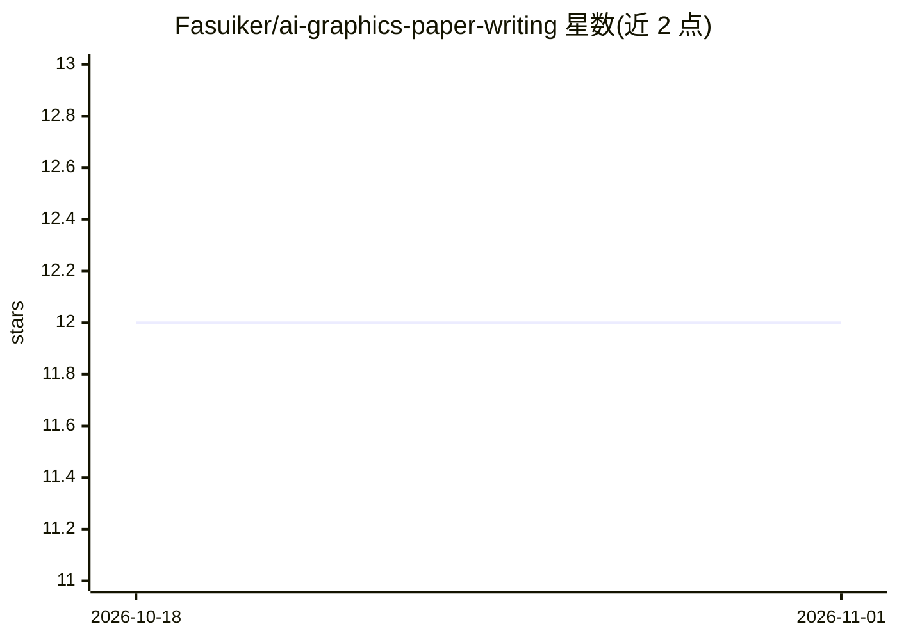

# Fasuiker/ai-graphics-paper-writing

⭐ 12 · MIT · 推送 2026-09-10 · [GitHub](https://github.com/Fasuiker/ai-graphics-paper-writing) · 个人维护 · 中文 README

**面向 AI/图形学论文写作的可填写模板与论证链 Skill**

以 Markdown 指令与参考资料构成的写作 Skill：包含 7 个章节模板文件、74 个可填写段落模块、289 个句子功能槽位，以及 36 篇论文来源卡和 105 条功能定位记录。按核心主张→关键困难→设计→证据的论证链组织起草、修订与断链检查，表达库区分 suggest/show empirically/prove 等强度。可直接阅读 Markdown，或克隆到 Codex skills 目录以 $ai-graphics-paper-writing 调用；说明为中文，填写句式为英文。

## 筛选速览

| 维度 | 判定 | 备注 |
|---|---|---|
| AI 角色 | `ai-knowledge` | 知识聚合/清单类 |
| 许可风险 | `permissive` | MIT |
| 部署形态 | `None` |  |
| 模型依赖 | — | README 未给出锁定关系 |
| 硬件要求 | — | 无带数字的原话,不猜 |
| 安装摩擦 | `low` | 无编译、无系统依赖或容器化 |
| 成熟度 | `idea` | |

## 能力要点

- 74 个可填写段落模块与 289 个句子功能槽位
- claim-challenge-design-evidence 论证链与断链检查
- 36 篇论文来源卡、105 条功能定位记录支撑模板
- 安装到 Codex 作为写作 Skill 使用，也可直接阅读 Markdown

## 适用场景

- 把研究材料组织成 AI/图形学方向的英文论文初稿
- 逐段逐句规划论文结构并检查论证断链
- 修改现有草稿时保留技术含义与引用键

## 场景标签

`AI 写作` `科研工具` · 领域:内容生成

## 证据(README 行号)

> L5: **面向 AI / AI＋图形学的论文写作 Skill：可填写模板 × 论文溯源 × 全文论证链**
> L11: 这个开源 skill 帮你把研究材料组织成论文：先厘清 **核心主张 → 关键困难 → 设计 → 证据**，再选择章节、段落和句子功能，完成起草、修订与检查。
> L61: 安装后重新打开 Codex 会话，使用 `$ai-graphics-paper-writing` 调用。仓库以 Markdown 指令和参考资料构成，安装后即可由助手加载使用。
> L163: Plan, draft, revise, and check manuscripts with 7 section files, 74 fillable paragraph modules, and 289 sentence-f

## 星数曲线

2026-10-18 12 → 2026-11-01 12（+0）

---
*卡片 v1 · prompt 1.4 · 生成 2026-11-01 · 置信度 high · 依据 README sha `fcb72097933c` · [字段定义](../../DATASET.md)*
