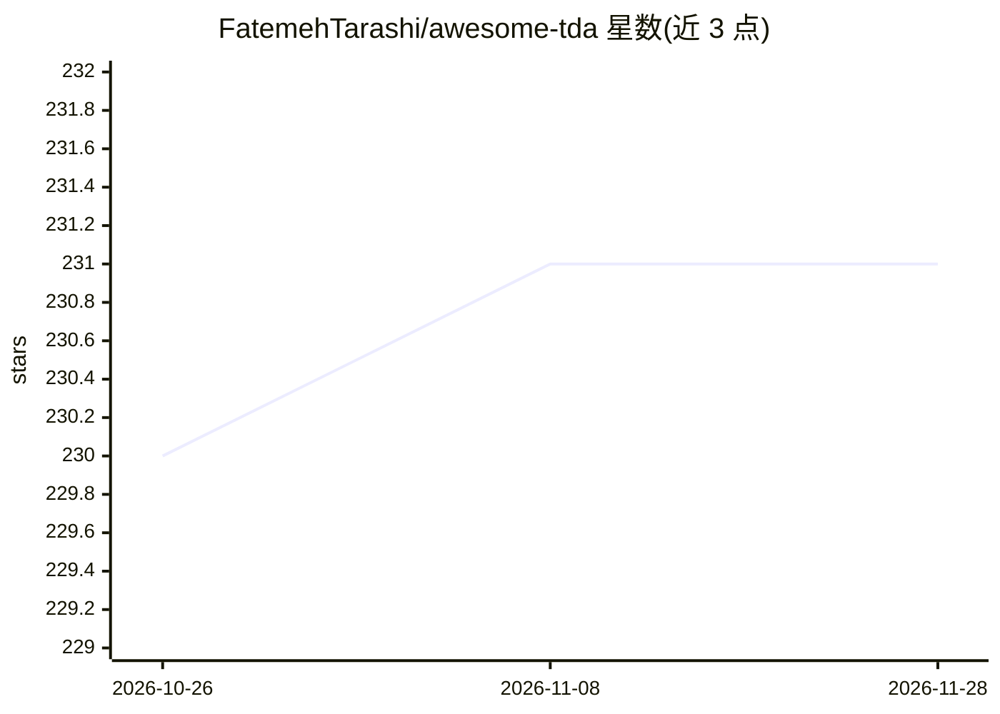

# FatemehTarashi/awesome-tda

⭐ 231 · CC0-1.0 · 推送 2026-11-23 · [GitHub](https://github.com/FatemehTarashi/awesome-tda) · 个人维护

**拓扑数据分析（TDA）工具与资源的策展清单**

收录拓扑数据分析领域的理论与学习资源及软件工具：理论部分包括算法、书籍、论文、课程和教程链接；工具部分按语言分类列出 C++、Go、Haskell、Java、Julia、Matlab、Python、R 的 TDA 库与框架，如 GUDHI、Ripser、Giotto-TDA 等。面向需要查找 TDA 文献和计算工具的研究者与开发者，由社区通过 fork/PR 或 issue 方式补充条目。

## 筛选速览

| 维度 | 判定 | 备注 |
|---|---|---|
| AI 角色 | `ai-knowledge` | 知识聚合/清单类 |
| 许可风险 | `viral` | CC0-1.0 |
| 部署形态 | `None` |  |
| 模型依赖 | — | README 未给出锁定关系 |
| 硬件要求 | — | 无带数字的原话,不猜 |
| 安装摩擦 | `medium` | 含编译或系统依赖之一 |
| 成熟度 | — | 结构信号不足 |

## 能力要点

- 按算法、书籍、论文、课程、教程组织的理论资源清单
- 按 C++/Python/R/Julia 等 8 种语言分类的 TDA 库目录
- 覆盖持久同调、Mapper、拓扑深度学习等主题的工具条目
- 社区可通过 PR 或 issue 贡献新条目

## 适用场景

- 查找持久同调计算库时按语言筛选可用工具
- 入门拓扑数据分析时寻找教程与课程资料
- 调研拓扑机器学习相关的论文与书籍

## 场景标签

`精选清单` · 领域:学习与行业

## 证据(README 行号)

> L3: A curated list of Topological Data Analysis (TDA) tools and resources.
> L86: ## Tools

## 星数曲线

2026-10-26 230 → 2026-11-28 231（+1）

---
*卡片 v1 · prompt 1.4 · 生成 2026-11-25 · 置信度 high · 依据 README sha `61a0e2e72bf2` · [字段定义](../../DATASET.md)*
