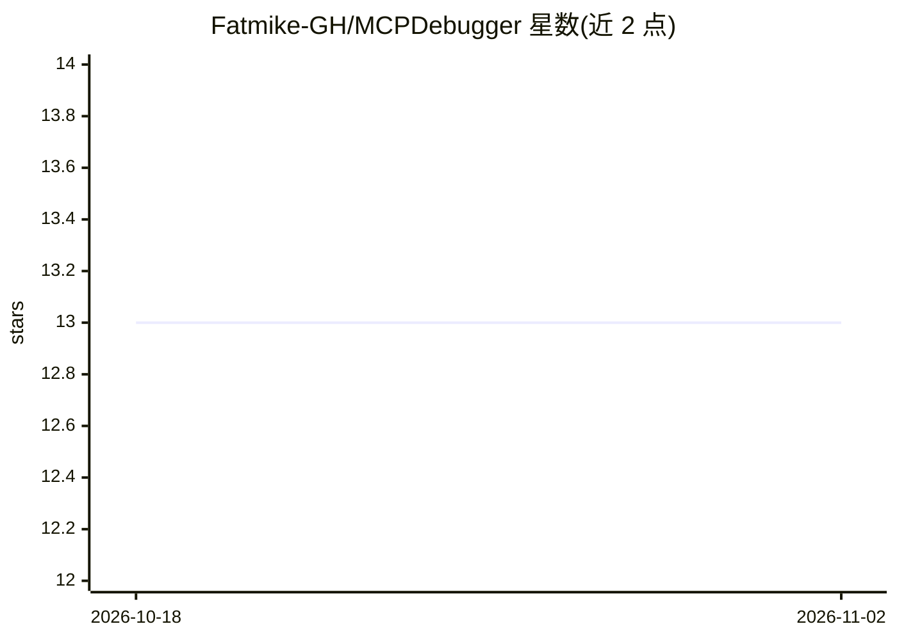

# Fatmike-GH/MCPDebugger

⭐ 13 · C · MIT · 推送 2026-04-01 · [GitHub](https://github.com/Fatmike-GH/MCPDebugger) · 个人维护

**面向 Windows 可执行文件的 MCP 调试器服务器，供 AI 客户端做动静分析**

用 C++ 从零实现的 Windows x86/x64 调试器（反汇编基于 Zydis），通过 C++/CLI 桥接暴露给 C# MCP 服务器（官方 MCP C# SDK 构建），将调试功能以 MCP 工具形式提供给外部 MCP 客户端（如 GitHub Copilot、Gemini CLI）。工具覆盖执行控制（断点/单步）、内存读写与反汇编、模块导入导出/节区检查等，面向想做逆向或动态分析的开发者。安装需在 Visual Studio 中编译解决方案生成 MCP.Server.exe，仅限 Windows，且同一时刻只能启用一种架构（x86 或 x64）。README 提示调试会产生高 token 消耗。

## 筛选速览

| 维度 | 判定 | 备注 |
|---|---|---|
| AI 角色 | `ai-ecosystem` | LLM/agent 周边工具 |
| 许可风险 | `permissive` | MIT |
| 部署形态 | `desktop` | 安装包/桌面程序 |
| 模型依赖 | — | README 未给出锁定关系 |
| 硬件要求 | — | 无带数字的原话,不猜 |
| 安装摩擦 | `low` | 无编译、无系统依赖或容器化 |
| 成熟度 | — | 结构信号不足 |

## 能力要点

- C++ 从零实现核心调试功能，不依赖现有调试器框架
- 以 MCP 工具形式暴露断点、单步、内存读写、模块检查等约 20 个调试操作
- 覆盖静态分析（导入/导出/节区）与动态分析（执行控制）两类场景
- 附 Example_x64 / Example_x86 示例目标与调试会话记录

## 适用场景

- 在支持 MCP 的 AI 客户端（如 Copilot Agent Mode）中调试和逆向 Windows 程序
- 让 AI 分析加壳或未知可执行文件的控制流与内存状态
- 通过自然语言驱动断点、单步与内存检查完成逆向任务

## 场景标签

`网络安全` · 领域:学习与行业

## 证据(README 行号)

> L5: This project is a self-made, lightweight **MCP Debugger Server** developed for learning and experimentation. The **M
> L7: The debugger is written in c++ and implements core debugging functionality from scratch without relying on existing 
> L168:  The C# MCP server that exposes debugger functionality as MCP tools for external clients.

## 星数曲线

2026-10-18 13 → 2026-11-02 13（+0）

---
*卡片 v1 · prompt 1.4 · 生成 2026-10-31 · 置信度 high · 依据 README sha `f4eaa1652b61` · [字段定义](../../DATASET.md)*
