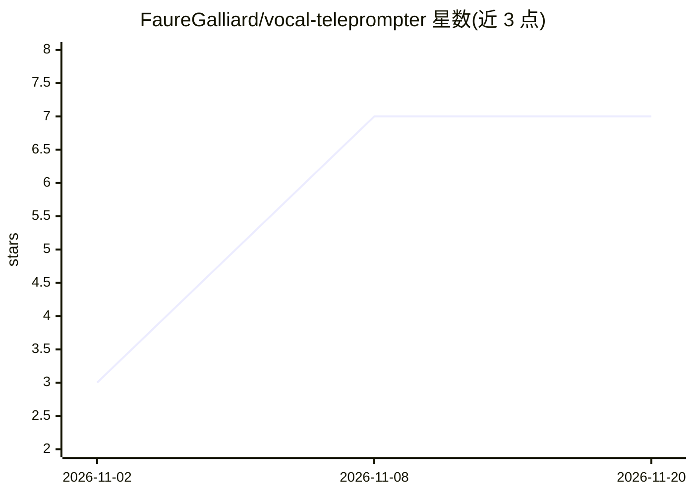

# FaureGalliard/vocal-teleprompter

⭐ 7 · TypeScript · MIT · 推送 2026-11-02 · [GitHub](https://github.com/FaureGalliard/vocal-teleprompter) · 个人维护

**跟随语音滚动的提词器，可对屏幕共享隐藏**

基于 Tauri 的桌面提词器：使用本地离线语音识别定位朗读位置，逐词滚动脚本，停顿或即兴发挥时等待、跳读时追上，支持 9 种语言。窗口可悬浮于幻灯片任意位置，带实时毛玻璃背景与自适应文字颜色；在 Windows 上可从 Zoom、Google Meet、Teams、OBS 等的屏幕共享中隐藏，Linux GNOME 通过 Shell 扩展实现。支持 `---` 分隔的幻灯卡片、语速与剩余时间统计、倒计时、脚本库、全局快捷键与一键更新。通过 MCP 连接 Claude Desktop、Claude Code、Cursor 或 VS Code 生成脚本。提供 Windows `.msi` 与 Linux AppImage/.deb/.rpm，MIT 许可，macOS 在路线图中。

## 筛选速览

| 维度 | 判定 | 备注 |
|---|---|---|
| AI 角色 | `ai-enhanced` | 去掉 AI 部分产品仍成立 |
| 许可风险 | `permissive` | MIT |
| 部署形态 | `desktop` | 安装包/桌面程序 |
| 模型依赖 | locked-api |  |
| 硬件要求 | — | 无带数字的原话,不猜 |
| 安装摩擦 | `low` | 无编译、无系统依赖或容器化 |
| 成熟度 | — | 结构信号不足 |

## 能力要点

- 离线语音识别驱动逐词滚动，9 种语言，全程本地运行
- Windows 上从 Zoom/Meet/Teams/OBS/Discord 屏幕共享中隐藏
- 实时毛玻璃背景，文字颜色随背景自适应
- 经 MCP 一键连接 Claude Desktop/Claude Code/Cursor/VS Code 生成脚本

## 适用场景

- 线上演示时照读提词且观众看不到提词器
- 录制讲解视频时按自己的语速滚动脚本
- 让 Claude 按每页幻灯片生成定时长的讲稿

## 场景标签

`语音识别` · 领域:感知与多模态

## 证据(README 行号)

> L27: No fixed speed, no foot pedal. Speech recognition finds where you are in the script and
> L64: prompter, split into slides and sized to your time. Connect Claude Desktop, Claude Code,

## 星数曲线

2026-11-02 3 → 2026-11-20 7（+4）

---
*卡片 v1 · prompt 1.4 · 生成 2026-11-20 · 置信度 high · 依据 README sha `603152c6f75d` · [字段定义](../../DATASET.md)*
