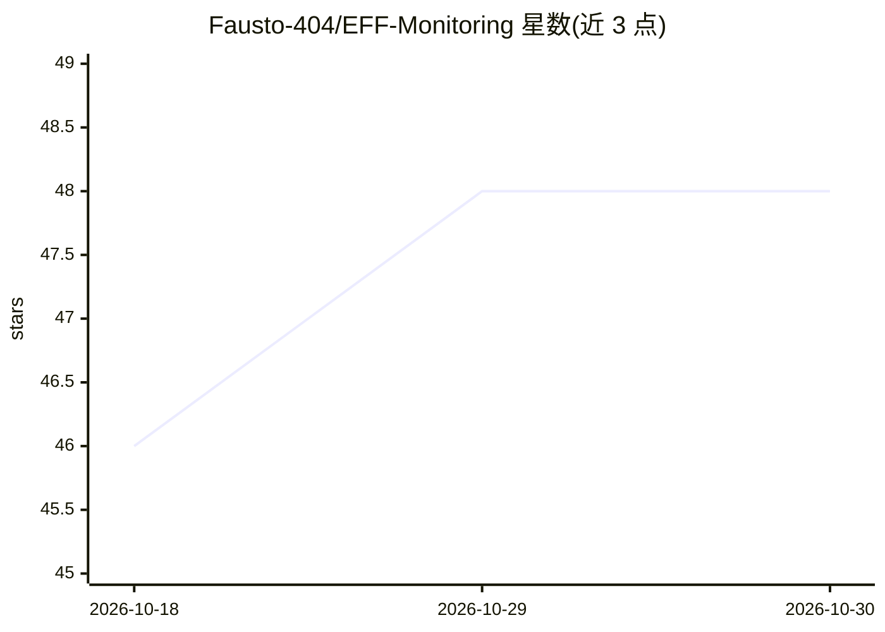

# Fausto-404/EFF-Monitoring

⭐ 48 · Python · Apache-2.0 · 推送 2026-10-29 · [GitHub](https://github.com/Fausto-404/EFF-Monitoring) · 个人维护 · 中文 README

**面向安全运营团队的告警协作与 AI 研判平台**

SOC 场景的告警协作平台：解析多设备原始日志为标准告警字段，关联资产、威胁情报与黑白名单；内置监测/研判/处置协作流程、五类角色与权限矩阵。AI 部分包括威胁分析/通用问答/报告生成三类 Agent（LangGraph）与告警智能研判引擎，输出结论、置信度与证据链；闭环告警可沉淀为 STE 经验供后续研判复用。支持 Docker 一键部署、浏览器插件接入、备份迁移与多格式报告导出；适配 OpenAI/DeepSeek/通义/智谱/月之暗面/Anthropic/Gemini/Ollama 等模型协议。

## 筛选速览

| 维度 | 判定 | 备注 |
|---|---|---|
| AI 角色 | `ai-enhanced` | 去掉 AI 部分产品仍成立 |
| 许可风险 | `permissive` | Apache-2.0 |
| 部署形态 | `self-host` | docker 或自建部署 |
| 模型依赖 | local-ok | 支持本地模型 |
| 硬件要求 | — | 无带数字的原话,不猜 |
| 安装摩擦 | `low` | 无编译、无系统依赖或容器化 |
| 成熟度 | — | 结构信号不足 |

## 能力要点

- 威胁分析/通用问答/报告生成三类 Agent，支持快速与思考两种模式
- 告警智能研判引擎输出研判标签、置信度、风险等级与证据链
- 闭环告警沉淀 STE 经验，供 AI 研判检索复用
- Docker 一键部署，支持离线镜像包与备份还原

## 适用场景

- SOC 值守统一处理态势感知、WAF、NDR、IPS 等设备的告警
- 攻防演练期间快速同步、研判和分发安全事件
- 把告警与资产、负责人、处置结果打通并输出报表

## 场景标签

`网络安全` · 领域:学习与行业

## 证据(README 行号)

> L27: + **协作闭环**：内置监测组、研判组、处置组协作流程，支持认领、释放、强制解锁、状态流转和消息提醒。
> L28: + **AI 增强**：AI 中心支持威胁分析、通用问答、报告生成三类 Agent，并提供快速 / 思考两种问答复杂度；告警详情内置智能研判引擎，统一输出研判标签、结论、置信度、风险等级和证据链。
> L181: |AI 中心|威胁分析 / 通用问答 / 报告生成 Agent、快速 / 思考模式、Markdown 对话、会话记忆、执行链路/证据包查看、STE 经验库、AI 经验提取、AI 生成消息模板|

## 星数曲线

2026-10-18 46 → 2026-10-30 48（+2）

---
*卡片 v1 · prompt 1.4 · 生成 2026-10-25 · 置信度 low · 依据 README sha `22a090d04f36` · [字段定义](../../DATASET.md)*
