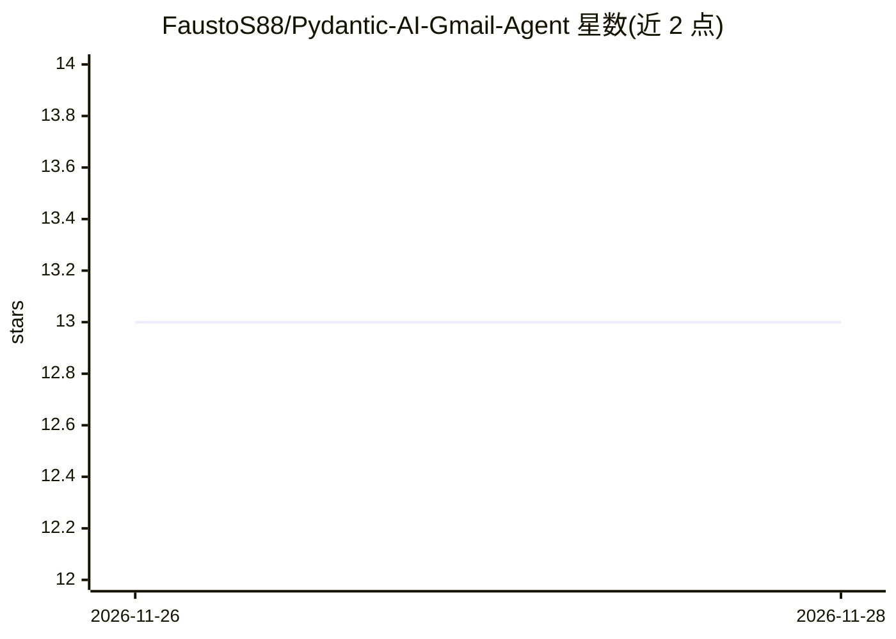

# FaustoS88/Pydantic-AI-Gmail-Agent

⭐ 13 · Python · AGPL-3.0 · 推送 2026-11-25 · [GitHub](https://github.com/FaustoS88/Pydantic-AI-Gmail-Agent) · 个人维护

**为 Gmail 用户自动分类加星邮件并起草回复的 Pydantic AI agent**

基于 Pydantic AI v2 的 Gmail 处理 agent：读取未读加星邮件及其线程上下文，由 agent 决定是否生成回复，以 Sofia 人格指令生成匹配语种的邮件草稿；同时移除星标并将收件箱推广邮件归档（每轮最多 100 封，不删除）。默认 draft 模式不注册发送工具，邮件仅存草稿供人工审核；auto 模式注册 send_reply 直接发送。需配置 OpenRouter API key 与 Google OAuth 凭据，token 自动刷新。

## 筛选速览

| 维度 | 判定 | 备注 |
|---|---|---|
| AI 角色 | `ai-native` | 本体是模型或模型工具 |
| 许可风险 | `viral` | AGPL-3.0 |
| 部署形态 | `library` | 以包/库形式分发 |
| 模型依赖 | locked-api |  |
| 硬件要求 | — | 无带数字的原话,不猜 |
| 安装摩擦 | `low` | 无编译、无系统依赖或容器化 |
| 成熟度 | — | 结构信号不足 |

## 能力要点

- 6 个原子 Gmail 工具（读取加星邮件、线程上下文、草稿、发送、移星、归档）
- draft 模式下发送工具不注册，防止邮件触发发送
- Thinking(effort="high") 扩展推理与 GmailResult 结构化输出
- OAuth token 自动刷新

## 适用场景

- 自动处理加星线程的未读邮件并生成待审核回复草稿
- 批量归档收件箱中的推广类邮件
- 以信任发件人的邮箱为对象开启 auto 直接发送模式

## 场景标签

`工作流自动化` · 领域:效率与自动化

## 证据(README 行号)

> L5: An intelligent, autonomous AI agent built with **Pydantic AI v2** to monitor, triage, and reply to Gmail messages.
> L13:  - `gmail_tools`: 6 atomic Gmail actions (`fetch_starred_emails`, `get_thread_context`, `create_reply_draft`, `send

## 星数曲线

2026-11-26 13 → 2026-11-28 13（+0）

---
*卡片 v1 · prompt 1.4 · 生成 2026-11-26 · 置信度 mid · 依据 README sha `901dce325b10` · [字段定义](../../DATASET.md)*
