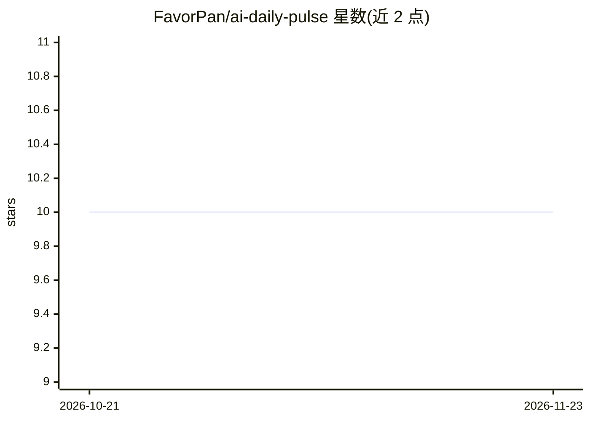

# FavorPan/ai-daily-pulse

⭐ 10 · TypeScript · MIT · 推送 2026-11-22 · [GitHub](https://github.com/FavorPan/ai-daily-pulse) · [官网](https://ai-daily-pulse.top) · 个人维护 · 中文 README

**AI 资讯自动化雷达：评分过滤 51 个 RSS 源生成每日双语摘要**

自动化 AI 新闻聚合管线：每日抓取 51 个中英文 RSS 源，经规则预过滤、AI 打分（0-10，保留≥5）、Jaccard+LLM 双级去重、中英双语摘要、跨源趋势聚类，并生成附难度/开发天数/变现方式的 build direction 创意（带社区投票）。结果输出 JSON 并由 GitHub Actions 每日定时提交，配套 Next.js 前端与 Cloudflare Workers 投票后端。依赖任意 OpenAI 兼容 API，README 给出单次运行成本约 $0.01-0.02 及重试、原子写入、空运行保护等可靠性机制。

## 筛选速览

| 维度 | 判定 | 备注 |
|---|---|---|
| AI 角色 | `ai-native` | 本体是模型或模型工具 |
| 许可风险 | `permissive` | MIT |
| 部署形态 | `library` | 以包/库形式分发 |
| 模型依赖 | local-ok | 支持本地模型 |
| 硬件要求 | — | 无带数字的原话,不猜 |
| 安装摩擦 | `low` | 无编译、无系统依赖或容器化 |
| 成熟度 | — | 结构信号不足 |

## 能力要点

- 51 个 RSS 源 + 规则预过滤 + AI 评分与阈值筛选的完整管线
- Jaccard 标题预过滤 + LLM 精确去重 + 90 天历史去重
- why_now fact-token grounding 检查，无需额外 LLM 调用
- GitHub Actions 每日定时运行，结果提交至 output/ 目录

## 适用场景

- 每天用一次打开即可浏览经过筛选的 AI 资讯摘要
- 按主题/关键词/日期范围检索历史 AI 文章
- 查看社区投票的 AI 项目 build direction 创意

## 场景标签

`工作流自动化` · 领域:效率与自动化

## 证据(README 行号)

> L18: 4. AI scores each article (0-10), keeps only high-quality content
> L20: 6. **Bilingual summaries**: Chinese + English summaries for every article
> L24: 10. **Build directions (Insight)**: AI-generated project ideas with difficulty, MVP days, monetization — community-

## 星数曲线

2026-10-21 10 → 2026-11-23 10（+0）

---
*卡片 v1 · prompt 1.4 · 生成 2026-11-20 · 置信度 high · 依据 README sha `76f2a8a2817a` · [字段定义](../../DATASET.md)*
