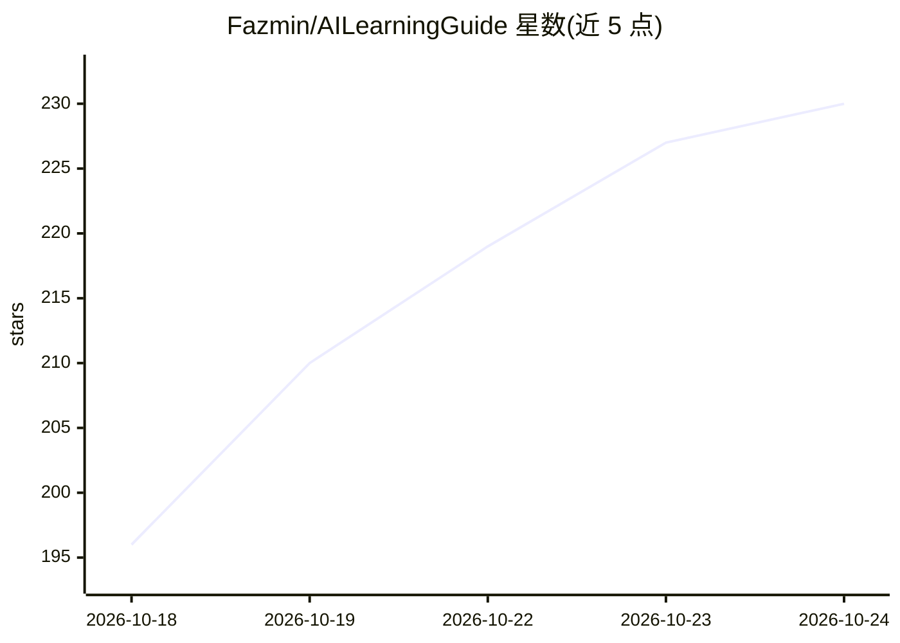

# Fazmin/AILearningGuide

⭐ 230 · TypeScript · MIT · 推送 2026-10-23 · [GitHub](https://github.com/Fazmin/AILearningGuide) · [官网](https://fazmin.github.io/AILearningGuide) · 个人维护

**面向学习者的桌面/网页 AI 教学应用：51 个互动实验讲解 AI 原理**

Discover AI 是一个教学应用，含 51 个互动实验，覆盖 ML 基础、transformer、RAG、agent、微调与量化等主题，分为六组并配Connections 地图展示知识关联。每个实验提供三档阅读难度（Simple/Plain/Standard）、检查题与进度保存；注意力实验在应用内运行真实小型 transformer，训练实验现场训练微型语言模型。可选 AI 向导支持本地小模型（下载 Qwen3.5 2B + llama.cpp 引擎，离线运行）或用户自有 OpenAI/Anthropic/Google API key。桌面版基于 Tauri 2/Rust，网页版提供 GitHub Pages 在线访问，无账号、无追踪，课程可离线使用。

## 筛选速览

| 维度 | 判定 | 备注 |
|---|---|---|
| AI 角色 | `ai-knowledge` | 知识聚合/清单类 |
| 许可风险 | `permissive` | MIT |
| 部署形态 | `desktop` | 安装包/桌面程序 |
| 模型依赖 | — | README 未给出锁定关系 |
| 硬件要求 | — | 无带数字的原话,不猜 |
| 安装摩擦 | `low` | 无编译、无系统依赖或容器化 |
| 成熟度 | — | 结构信号不足 |

## 能力要点

- 51 个互动实验分六组，覆盖 ML 基础到微调、量化与部署
- 应用内运行真实小型 transformer 与现场训练的微型语言模型
- 三档阅读难度（Simple/Plain/Standard）与检查题、进度保存
- 可选 AI 向导：本地 Qwen3.5 2B + llama.cpp 离线运行，或自带云端 API key

## 适用场景

- 零基础按顺序系统学习现代 AI 的工作原理
- 通过拖动滑块、点击词语等互动操作直观理解注意力与反向传播
- 离线、无账号、无追踪地自学 AI 课程并跟踪进度

## 场景标签

`教程课程` · 领域:学习与行业

## 证据(README 行号)

> L3: A desktop app that teaches you how modern AI works by letting you play with it.
> L5: There are 51 small hands-on labs. In each one you move a slider, click a word, or train a tiny model, and you watch 

## 星数曲线

2026-10-18 196 → 2026-10-24 230（+34）

---
*卡片 v1 · prompt 1.4 · 生成 2026-10-22 · 置信度 high · 依据 README sha `ae3dc0045355` · [字段定义](../../DATASET.md)*
