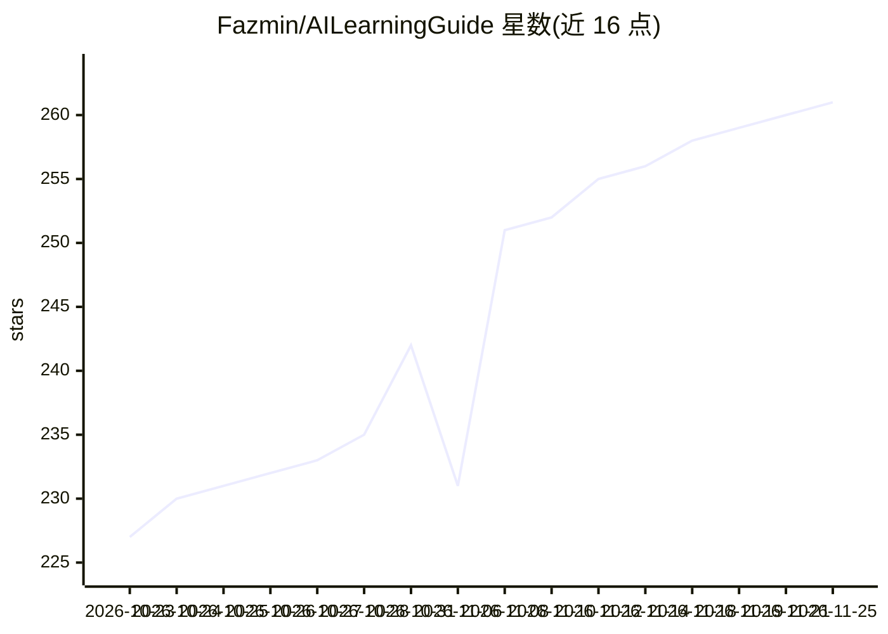

# Fazmin/AILearningGuide

⭐ 261 · TypeScript · MIT · 推送 2026-11-21 · [GitHub](https://github.com/Fazmin/AILearningGuide) · [官网](https://fazmin.github.io/AILearningGuide) · 个人维护

**交互式 AI 学习桌面应用：62 个动手实验室自学机器学习**

以桌面/Web 应用形式提供的 AI 交互式教程：62 个实验分布在七个模块，覆盖数学基础、神经网络、transformer、RAG、agent、预训练与微调量化等主题，每个实验配 Simple/Plain/Standard 三档讲解、checkpoint 测验、进度保存与词汇表搜索。应用内可实时运行小型 transformer 与训练小语言模型。附带可选 AI 问答助手（本地 llama.cpp 模型或用户自备 API key），离线可用，MIT 许可。

## 筛选速览

| 维度 | 判定 | 备注 |
|---|---|---|
| AI 角色 | `ai-knowledge` | 知识聚合/清单类 |
| 许可风险 | `permissive` | MIT |
| 部署形态 | `desktop` | 安装包/桌面程序 |
| 模型依赖 | — | README 未给出锁定关系 |
| 硬件要求 | — | 无带数字的原话,不猜 |
| 安装摩擦 | `low` | 无编译、无系统依赖或容器化 |
| 成熟度 | — | 结构信号不足 |

## 能力要点

- 62 个交互实验分七组，覆盖从数学基础到微调、量化与服务化
- 应用内实时运行小型 transformer 并可现场训练小语言模型
- 三种阅读模式、进度保存、Cmd+K 全局搜索与无障碍选项
- 可选 AI 助手：本地 Qwen 模型（llama.cpp）或 OpenAI/Anthropic/Google 自备 key

## 适用场景

- 想通过拖动滑块、动手实验的方式自学机器学习与 transformer 原理
- 需要离线、无账号的 AI 入门学习材料
- 教学中向学生演示注意力、梯度下降、训练过程等概念
- 用 checkpoint 测验和进度追踪安排自己的学习路线

## 场景标签

`教程课程` · 领域:学习与行业

## 证据(README 行号)

> L3: A desktop app that teaches you how modern AI works by letting you play with it.
> L5: There are 62 small hands-on labs. In each one you move a slider, click a word, or train a tiny model, and you watch 
> L79: - **62 interactive labs.** Each lab is split into a few short steps with a "Try this" hint, so you always know what

## 星数曲线

2026-10-23 227 → 2026-11-25 261（+34）

---
*卡片 v1 · prompt 1.4 · 生成 2026-11-25 · 置信度 high · 依据 README sha `36cd940c4be2` · [字段定义](../../DATASET.md)*
