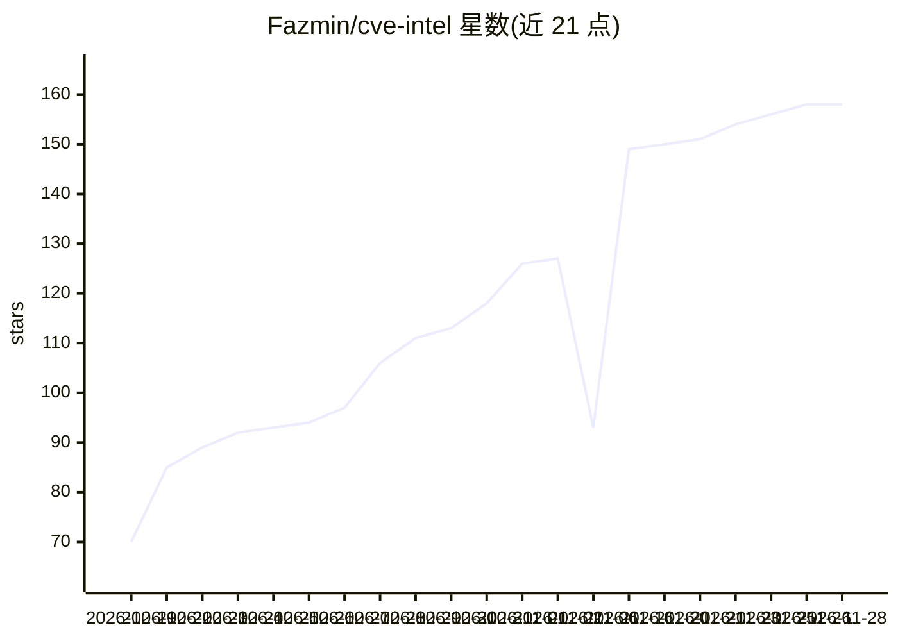

# Fazmin/cve-intel

⭐ 158 · Rust · Apache-2.0 · 推送 2026-11-27 · [GitHub](https://github.com/Fazmin/cve-intel) · 个人维护

**本地优先的 CVE 分诊与修复规划工具，供安全/开发团队用**

以 Rust + Tauri 2 编写的本地漏洞分诊桌面应用，含 CLI、REST API 与 42 个 MCP 工具的 MCP server。输入 CVE ID、项目文件夹、lockfile/SBOM、容器镜像或 IP/域名等，查询 CISA KEV、EPSS、ENISA、NVD 等最多 46 个公开数据源，输出 0–100 风险评分、利用证据与修复建议；支持读写 CycloneDX/SPDX SBOM，fleet 模式通过各机器上的 agent 收集软件清单并由自建服务器集中比对。默认无账户、无托管服务，AI 助手默认使用本地模型。MIT OR Apache-2.0 双许可。

## 筛选速览

| 维度 | 判定 | 备注 |
|---|---|---|
| AI 角色 | `ai-enhanced` | 去掉 AI 部分产品仍成立 |
| 许可风险 | `permissive` | Apache-2.0 |
| 部署形态 | `desktop` | 安装包/桌面程序 |
| 模型依赖 | local-ok | 支持本地模型 |
| 硬件要求 | — | 无带数字的原话,不猜 |
| 安装摩擦 | `low` | 无编译、无系统依赖或容器化 |
| 成熟度 | — | 结构信号不足 |

## 能力要点

- 42 个 MCP 工具供 AI agent 与编码助手调用
- 46 个数据源聚合输出 0–100 风险评分与证据
- SBOM 读写：解析 CycloneDX/SPDX 与 lockfile，导出 CycloneDX 1.5
- fleet 模式从一处监控多台服务器的软件清单与 CVE 命中

## 适用场景

- 判断某个 CVE 是否影响自己的软件栈并决定是否立即修补
- 扫描项目依赖或本机软件找出有漏洞的包和修复版本
- 从一台服务器集中监控整个机队的漏洞暴露情况
- 通过 MCP 让 AI 编码助手获得同样的漏洞情报

## 场景标签

`网络安全` · 领域:学习与行业

## 证据(README 行号)

> L4:  A private desktop app for vulnerability triage and scanning, written in native Rust, with a CLI, REST API and MCP s
> L6:  42 MCP tools, 46 data sources, SBOMs in and out, on-device AI.
> L74:  straight from your computer to the public sources, and the AI assistant
> L121: - **Ask in plain English:** the assistant looks up the facts first and
> L123: - **Give AI coding assistants the same knowledge** through MCP.

## 星数曲线

2026-10-19 70 → 2026-11-28 158（+88）

---
*卡片 v1 · prompt 1.4 · 生成 2026-11-27 · 置信度 mid · 依据 README sha `760db2862226` · [字段定义](../../DATASET.md)*
